# Controle de Demandas de Mudanças

Sistema do DITIC-DSUP (Tribunal de Justiça do RS) para acompanhar as demandas de mudança de equipamentos de
informática, do expediente SEI à conclusão. Substitui a planilha usada hoje pelo setor.

## Como funciona

```mermaid
flowchart LR
    A([Expediente SEI chega]) --> B[Nova demanda<br/>local, datas e responsável]
    B --> C[Tickets do 4Biz<br/>ticket principal e subtickets]
    C --> D[Acionar<br/>gera o texto para o SEI]
    D -->|na Data de Início| E[Em Atendimento]
    E -->|um dia depois da<br/>Data para Conclusão| F[Para Validação]
    F --> G[Relatório de execução<br/>PDF com o custo]
    G --> H([Concluída<br/>fica com o Setor])
```



- **Pendente → Acionada:** à mão, depois de registrar o ticket principal e a Data de Início. Acionada por engano volta
  para Pendente (à mão, mantendo tickets e datas).
- **Em Atendimento e Para Validação:** o sistema muda sozinho, pelas datas, sem trocar o responsável.
- **Concluída:** técnico ou administrador conclui a partir de Para Validação. Até lá, o administrador pode cancelar.
- **Histórico:** cada alteração fica registrada com quem fez e quando.

## Quem faz o quê

| | Sem login | Técnico | Administrador |
|---|:---:|:---:|:---:|
| Ver a lista, os cards e o histórico | ✓ | ✓ | ✓ |
| Incluir, editar, acionar e concluir demandas | | ✓ | ✓ |
| Gerar o texto de acionamento e o relatório em PDF | | ✓ | ✓ |
| Cancelar, excluir e restaurar da lixeira | | | ✓ |
| Equipe (incluir e excluir pessoas), pedidos de acesso e Configuração de valores | | | ✓ |

Qualquer pessoa vê no que o setor está trabalhando, só para consulta. Para alterar, é preciso clicar em **Entrar**,
com usuário e senha; a **Nova demanda** só aparece depois disso. Quem não tem conta pede acesso na tela de entrada, e o
administrador aprova em **Equipe**. O administrador é um só (a conta `admin`); toda conta nova é de técnico. Ao excluir
um técnico, as demandas em aberto passam antes para outra pessoa; quem já aparece no histórico fica só desativado,
para o nome continuar nos registros.

## Instalação

Precisa de Java 17 e MySQL 8.

1. **Banco:** no MySQL Workbench, como root, abra `db/ditic_mudancas_db.sql`, troque `TROCAR_SENHA` pela senha do
   `ditic_admin` (sem salvar o arquivo) e execute. O script cria as tabelas e carrega os locais, as empresas, os
   serviços e os valores do custo.
2. **Configuração:** na raiz do projeto, copie `application-local.properties.exemplo` para
   `application-local.properties` e preencha a senha do banco e a senha inicial do administrador. Esse arquivo fica
   fora do Git e fora do `.jar`.
3. **Aplicação:** rode `ControleMudancasApplication` no IntelliJ (ou `mvnw.cmd spring-boot:run`) e abra
   `http://localhost:8088`.
4. **Primeiro acesso:** entre com `admin` e a senha inicial, crie a sua senha e troque o nome "Administrador" pelo seu
   em **Equipe**. Depois inclua a equipe: cada pessoa recebe uma senha temporária, válida por 24 horas.

**Para testar com dados:** depois do primeiro acesso, rode `db/dados_ficticios.sql` no Workbench. Ele cria 5 técnicos
e 28 demandas de exemplo, em todas as situações, com tickets, subtickets e histórico; as datas acompanham o dia em que
o script roda. Os técnicos de exemplo entram depois que o administrador usar **Redefinir senha** em Equipe. Não use em
produção.

Para redefinir a senha do administrador (ou sem acesso a ele), inicie a aplicação com `--mudancas.redefinir-senha=<usuário>`: a senha temporária
aparece no console.

### No servidor

1. **Banco:** rode `db/ditic_mudancas_db.sql` como root (passo 1 acima). O script cria o usuário `ditic_admin` só com
   leitura e gravação de dados. Para usar um usuário do MySQL que já existe, apague as linhas `CREATE USER` e `GRANT`
   antes de rodar e dê a ele `SELECT, INSERT, UPDATE, DELETE` no banco `ditic_mudancas_db`.
2. **Pacote:** nesta máquina, `mvnw.cmd clean package -DskipTests` gera `target/controle-mudancas-1.0.0.jar`.
3. **Pasta do sistema:** copie o `.jar` e o `iniciar.bat` para a mesma pasta. No `iniciar.bat` dessa cópia, preencha
   `SENHA_INICIAL_ADMIN` (nunca na cópia do Git). Sem `application-local.properties`, o sistema entra no MySQL local
   como `ditic_admin`, sem senha. Se o banco tiver senha, ou estiver em outra máquina, crie o
   `application-local.properties` na mesma pasta (modelo em `application-local.properties.exemplo`). Com HTTPS, ligue
   `server.servlet.session.cookie.secure=true`.
4. **Iniciar:** dois cliques no `iniciar.bat` (precisa do Java 17 ou mais novo). Enquanto a janela estiver aberta, o
   sistema fica em `http://localhost:8088` e o navegador abre sozinho; para parar, feche a janela. Para o sistema voltar
   sozinho quando a máquina reiniciar, ele pode ser instalado como serviço do Windows.
5. **Primeiro acesso:** como no passo 4 acima. O `admin` só é criado se ainda não existir no banco; depois disso, a
   senha inicial do arquivo não vale mais e pode sair de lá.

Não rode `db/dados_ficticios.sql` no servidor.

**Backup:** dois cliques no `backup.bat` geram, na pasta dele, `backup_ditic_mudancas_AAAA-MM-DD_HHMM.sql`, com as
tabelas e todos os dados (pode rodar com o sistema no ar). Para restaurar, abra o arquivo no Workbench, como root, e
execute: ele recria o banco com os dados do backup. Guarde as cópias fora da máquina; os backups ficam fora do Git.

## Testes

```bash
mvnw.cmd test                                  # testes JUnit da API e das regras (banco H2 em memória)

mvnw.cmd test-compile spring-boot:test-run     # servidor de teste, em um terminal
python src/test/e2e/teste_ponta_a_ponta.py     # teste das telas (Playwright), em outro terminal
```

## Estrutura

| Pasta | Conteúdo |
|---|---|
| `db/` | script do banco |
| `src/main/java/` | aplicação Spring Boot: regras em `service/`, API em `controller/` |
| `src/main/resources/static/` | telas (HTML, CSS e JavaScript, com Bootstrap local) |
| `src/test/` | testes JUnit e o teste das telas |

## Tecnologias

Java 17 · Spring Boot 4 · Spring Security · MySQL · HTML, CSS e JavaScript puro · Bootstrap 5.3 · JUnit · Playwright

## Autoria

Desenvolvido por Marcelo Luis da Silva Diehl para uso do DITIC-DSUP/TJRS. Os termos de uso estão em
**Informações do Sistema**, no rodapé da aplicação.
