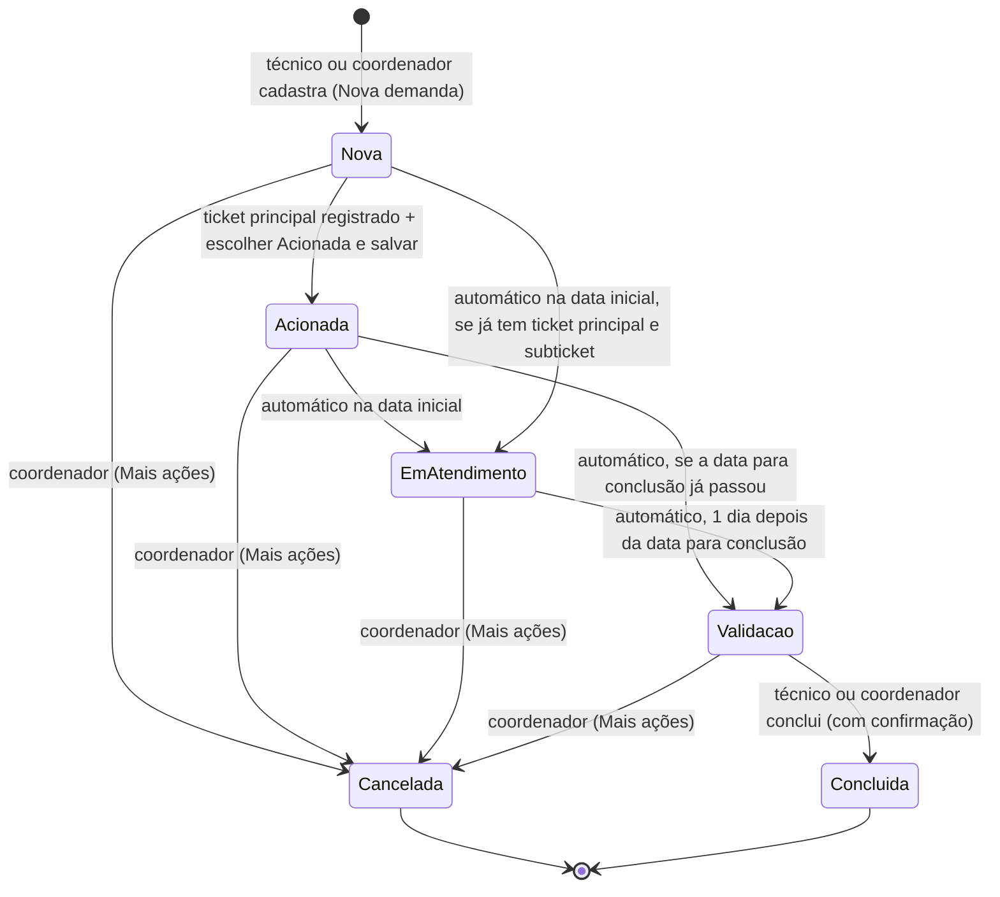

# Especificação funcional: Controle de Demandas de Mudanças

Protótipo navegável (front-end completo, sem back-end) do sistema que vai substituir a planilha Excel
**"Controle de Mudanças"** do Departamento de Suporte (DSUP) da Direção de Tecnologia da Informação e
Comunicação (DITIC) do Tribunal de Justiça do Rio Grande do Sul.

- **Autor:** Marcelo Luis da Silva Diehl (DITIC-DSUP)
- **Versão:** 1.0.0 (novembro/2026)
- **Situação:** regras de negócio e telas validadas com o setor. O próximo passo é o back-end
  (Java/Spring Boot + MySQL), usando este protótipo como especificação.

> **Para quem for continuar o projeto (inclusive o Claude):** este documento é a especificação funcional.
> Tudo o que está aqui foi decidido junto com o setor. Antes de mudar uma regra ou o visual, veja a
> seção [Decisões já tomadas](#14-decisões-já-tomadas-não-reverter-sem-falar-com-o-setor).

---

## Sumário

1. [A proposta](#1-a-proposta)
2. [Como abrir](#2-como-abrir)
3. [Arquivos](#3-arquivos)
4. [Glossário](#4-glossário)
5. [Perfis e permissões](#5-perfis-e-permissões)
6. [Fluxo da demanda](#6-fluxo-da-demanda)
7. [Regras de negócio](#7-regras-de-negócio)
8. [Telas](#8-telas)
9. [Textos gerados](#9-textos-gerados-acionamento-tickets-relatório-pdf)
10. [Modelo de dados do protótipo](#10-modelo-de-dados-do-protótipo)
11. [Proposta de banco de dados (MySQL)](#11-proposta-de-banco-de-dados-mysql)
12. [API REST sugerida](#12-api-rest-sugerida)
13. [Front-end: organização do código](#13-front-end-organização-do-código)
14. [Decisões já tomadas](#14-decisões-já-tomadas-não-reverter-sem-falar-com-o-setor)
15. [Legado: a planilha atual](#15-legado-a-planilha-atual)
16. [Próximos passos](#16-próximos-passos)

---

## 1. A proposta

Hoje cada demanda de mudança de equipamentos de informática (mudança de local, mudança de prédio,
instalação, desinstalação, rollout) é controlada numa planilha compartilhada. Uma cor de linha indica a
situação, e os números de ticket ficam espalhados em colunas. O sistema novo:

- registra a demanda a partir do **expediente SEI** e a atribui a um técnico;
- guarda o **ticket principal** e os **subtickets** do 4Biz (um por empresa contratada e serviço, com a
  quantidade de serviços);
- muda a situação **sozinho pelas datas do agendamento**, sem tirar a demanda de quem está com ela;
- gera os textos que hoje são escritos à mão (**informação de acionamento** para o SEI e **relatório de
  execução em PDF** no modelo-mestre do DSUP);
- mantém o **histórico completo** de cada demanda (quem fez o quê e quando);
- prepara a base para **relatórios e análise de dados** (chamados por mês, tickets por empresa, regiões).

### O fluxo real do setor

1. A demanda chega ao DITIC-DSUP por um **expediente SEI**.
2. O **coordenador** ou um **técnico** cadastra a demanda no sistema e a atribui a um responsável.
3. O técnico abre no **4Biz** o ticket principal e os subtickets (um por empresa/serviço). Depois registra
   no sistema os números, os serviços, as quantidades e a empresa, e marca a demanda como **Acionada**.
4. Na data agendada, a situação vira **Em atendimento** sozinha. A demanda continua com o responsável.
5. Um dia depois da data para conclusão, vira **Para Validação**, ainda com o responsável.
6. Quem está com a demanda gera o **relatório de execução** para o expediente SEI e **conclui** a demanda.
   O técnico pode levar a demanda do cadastro à conclusão; se precisar, passa a outra pessoa trocando o
   Responsável.
7. Concluída, a demanda fica com o **Setor (DSUP)**, sem atribuição; o histórico guarda quem atendeu.

---

## 2. Como abrir

- Dê um duplo clique em `index.html`. Funciona **sem internet**: Bootstrap, fontes e scripts estão todos
  na pasta. Use navegadores atuais: Chrome, Edge ou Firefox.
- Os dados ficam no **localStorage do navegador** (chave `ditic-dsup-mudancas-v5`). Cada navegador tem os
  seus dados.
- O sistema começa **sem nenhuma demanda e sem nenhum técnico**: só o coordenador existe até ele cadastrar a
  equipe. Os cards são criados em Nova demanda.
- **Login no protótipo:** coordenador com o usuário `admin`, qualquer senha, ou o botão **Entrar como coordenador**
  no modal de login (o primeiro acesso exige criar uma nova senha). Técnico com o usuário mostrado na Equipe,
  qualquer senha. **Sem entrar, o sistema é só para consulta.**
- **No Spring Boot:** rode `ControleMudancasApplication` no IDE e abra `http://localhost:8088`. A tela é
  servida de `src/main/resources/static/`, cópia da pasta `front_end/`. Os pontos marcados com `API:` no
  JavaScript viram chamadas `fetch` (ver [seção 12](#12-api-rest-sugerida)).

---

## 3. Arquivos

```
front_end/
├── index.html                    página única: Bootstrap local + tema + script (com Content-Security-Policy)
├── css/
│   └── mudancas.css              tema visual: variáveis, tema do Bootstrap (--bs-*) e componentes próprios
├── js/
│   └── mudancas.js               JavaScript puro, em três partes: catálogos, gerador de PDF, aplicação
├── vendor/bootstrap/
│   ├── bootstrap.min.css         Bootstrap 5.3.3 (só o CSS; o comportamento é do mudancas.js)
│   └── LICENSE.txt               licença MIT
├── fonts/                        Inter (400/500/600/700) e IBM Plex Mono (400/500/600), woff2 + licenças OFL
├── testes/
│   └── teste_ponta_a_ponta.py    teste automático dos fluxos (opcional; precisa de Python + Playwright)
├── README.md                     apresentação da pasta
└── CLAUDE.md                     orientação curta para o Claude Code
```

São **três arquivos do sistema** (HTML, CSS e JS). `vendor/` e `fonts/` são dependências locais, para não
depender de CDN.

---

## 4. Glossário

| Termo | Significado |
|---|---|
| **Expediente SEI** | Processo administrativo que origina a demanda. Formato `8.AAAA.NNNN/NNNNNN-D` (ex.: `8.2026.9745/000342-7`). Há demandas "fora do SEI". |
| **4Biz** | Sistema de chamados (ITSM) do TJRS. |
| **Ticket principal** | Chamado do 4Biz que representa a demanda inteira (sempre 6 dígitos). |
| **Subticket** | Chamado do 4Biz para uma empresa contratada e um serviço, com a quantidade de serviços. |
| **Empresas** | CADI, CDS, Selbetti e WECOM. CDS e WECOM são pagas por serviço; CADI e Selbetti estão no valor global do contrato. |
| **Coordenador** | Quem coordena as mudanças no DSUP. Faz tudo o que o técnico faz e ainda cancela, exclui, restaura da lixeira, aprova acessos e mantém Equipe e Configuração. No sistema: "Administrador". |
| **Técnico** | Colega do DSUP que cria, atende e conclui demandas, com login próprio (ver [seção 5](#5-perfis-e-permissões)). |
| **Carga** | Com quem a demanda está agora: técnico, coordenador ou Setor. |
| **Setor** | O DSUP como um todo. Demanda concluída não tem mais responsável individual. |
| **Local** | Prédio de Porto Alegre (13 prédios, região Metropolitana) ou comarca do interior (164 comarcas, cada uma com a sua região). No interior, o nome do prédio é "Foro da Comarca de X". |
| **DMP** | Depósito de material; aparece como origem ou destino no relatório (instalação e desinstalação). |
| **Bolinha azul** | Aviso de que a demanda chegou a alguém, mudou de responsável ou mudou de status, e o card ainda não foi aberto. |
| **Lixeira** | Onde a demanda excluída fica por 30 dias, podendo ser restaurada. |

---

## 5. Perfis e permissões

**Alterar exige login, de técnico ou de coordenador.** Sem entrar, o protótipo mostra tudo só para consulta (no sistema
real, nem a consulta é aberta: ver [Login e contas](#login-e-contas-desenho-aprovado-entra-com-o-back-end)). O técnico
faz tudo nas demandas. **Qualquer técnico ou coordenador edita qualquer demanda em aberto, a qualquer momento**; cada
alteração entra no histórico em nome de quem a fez.

| Ação | Técnico | Coordenador |
|---|:---:|:---:|
| Consultar lista, filtros, detalhes e histórico | ✓ | ✓ |
| **Nova demanda** | ✓ | ✓ |
| Editar Detalhes (SEI, local, descrição, responsável, datas, hora, informações), em qualquer etapa em aberto ([seção 7.2](#72-mudança-de-status-à-mão)) | ✓ | ✓ |
| Registrar ou alterar o ticket principal, incluir/remover subtickets, mudar serviço, quantidade e metro linear, em qualquer etapa em aberto | ✓ | ✓ |
| Registrar andamento no histórico | ✓ | ✓ |
| Status: Nova → Acionada | ✓ | ✓ |
| Gerar informação de acionamento / copiar tickets em texto | ✓ | ✓ |
| Gerar relatório de execução (PDF) | ✓ | ✓ |
| **Concluir** demanda (em Para Validação) | ✓ | ✓ |
| **Cancelar** demanda (antes de concluída, com motivo) | — | ✓ |
| **Excluir** demanda (com motivo; vai para a Lixeira; não vale para Concluída) | — | ✓ |
| **Lixeira** (consultar e restaurar) | — | ✓ |
| **Aprovar solicitações de acesso** (sistema real) | — | ✓ |
| **Equipe** (incluir, editar, transferir, desativar, reativar) | — | ✓ |
| **Configuração** (valores do custo do relatório) | — | ✓ |

Qualquer alteração tentada sem login abre o modal de login; depois de entrar, a ação continua. Ação do coordenador
tentada por um técnico mostra "Somente o coordenador pode fazer isso".

Em demanda Concluída ou Cancelada, as edições acima deixam de valer para todos os perfis
([seção 7.2](#72-mudança-de-status-à-mão)).

### Login e contas (desenho aprovado; entra com o back-end)

A tabela acima descreve o protótipo. No sistema real, por enquanto sem AD/LDAP do TJRS:

- **Tudo fica atrás do login.** Não há consulta anônima. O servidor valida cada permissão.
- **Todos têm conta, com login próprio:** perfil Coordenador ou Técnico. Pode haver mais de um coordenador. As permissões de
  cada perfil continuam as da tabela acima.
- **Um técnico pode alterar a demanda de outro.** Cada alteração fica registrada no histórico em nome de quem a fez.
- **Com mais de um coordenador, a carga é compartilhada:** todos os coordenadores veem exatamente as mesmas demandas.
- **Solicitação de acesso:** a pessoa pede acesso na tela de login (nome e usuário). A solicitação fica pendente,
  sem entrar no sistema, até um **coordenador aprovar** em **Equipe**, definindo perfil e cor; recusar descarta o pedido.
  O coordenador também pode criar a conta direto em Equipe (nome, usuário, perfil, cor). Equipe e contas são um
  cadastro só: todo responsável tem conta, e quem ainda não fez o primeiro login já pode receber demandas.
- **Primeiro acesso:** o sistema gera uma senha temporária, mostrada uma única vez e válida por 24 horas. No primeiro
  login, a pessoa é obrigada a criar a senha pessoal. O primeiro coordenador é criado na instalação, com
  `mudancas.admin.senha-inicial`, e também troca a senha.
- **A Equipe mostra** nome, usuário, perfil, situação do acesso (Aguardando primeiro acesso, Ativo, Desativado) e
  último acesso. Ninguém vê a senha de ninguém: o servidor guarda só o hash (BCrypt).
- **Esqueci a senha:** a tela de login orienta a procurar o coordenador. O coordenador usa **Redefinir senha** na Equipe; outro
  coordenador redefine a senha de um coordenador. Sem nenhum coordenador disponível, o responsável pelo servidor gera uma senha
  temporária por comando administrativo. A redefinição cancela a senha anterior, derruba as sessões da pessoa e fica
  registrada, sem a senha.
- **Desativar** bloqueia a entrada e mantém o histórico.
- **Sessão no servidor** com cookie protegido e encerramento por inatividade, proteção CSRF, bloqueio temporário após
  várias tentativas erradas e registro de entradas e falhas.
- **Com todos logados:** o histórico grava o autor real e a bolinha azul só some quando o destinatário abre o card.
- **AD/LDAP no futuro:** a verificação de senha fica isolada em um ponto do back-end; trocar por AD muda só esse ponto.

---

## 6. Fluxo da demanda



| Situação | Cor | Carga (com quem está) | Como entra | Status no card |
|---|---|---|---|---|
| **Nova** | branco | responsável (no mínimo, o coordenador) | Nova demanda | escolha + Salvar alterações; na Data de Início, avança sozinha se já tem ticket principal e subticket |
| **Acionada** | amarelo | responsável | escolha + Salvar; exige ticket principal | automático; avança pela data |
| **Em atendimento** | azul | responsável (continua o mesmo) | automático na data de agendamento | automático (cadeado) |
| **Para Validação** | laranja | responsável (continua o mesmo) | automático 1 dia após a data para conclusão | automático |
| **Concluída** | verde | Setor (sem responsável) | botão Concluir demanda (técnico ou coordenador) | final, para todos |
| **Cancelada** | cinza (texto riscado) | quem estava | coordenador | final, para todos |

Nas etapas em aberto, **só o status é automático**: dados, responsável e tickets continuam editáveis.

"Em aberto" = Nova + Acionada + Em atendimento + Para Validação (em desenvolvimento).
"Encerradas" = Concluída + Cancelada.

---

## 7. Regras de negócio

### 7.1 Automação pelas datas

O protótipo roda esta automação ao abrir e de hora em hora. **No sistema real, ela deve rodar no
servidor** (tarefa agendada diária, ex.: `@Scheduled` no Spring).

1. Demanda **Acionada** com `data inicial ≤ hoje` (só a data, sem a hora) vira **Em atendimento**. A carga
   **continua com o responsável**, que recebe o aviso (bolinha azul).
   **Nova** na mesma condição também vira Em atendimento **se já tem ticket principal e ao menos um subticket**
   (não foi marcada como Acionada, mas as empresas já foram acionadas). A data do acionamento é a do registro do
   ticket principal. Sem esses tickets, ela **continua Nova** e ganha o sinal vermelho
   ([seção 8.1](#81-lista-tela-principal)).
2. Demanda **Acionada ou Em atendimento** com `(data para conclusão ou, sem ela, data inicial) < hoje` vira
   **Para Validação**, também sem trocar o responsável, com aviso para ele.
   A **data do acionamento nunca é depois da Data de Início**: se o ticket foi registrado (ou a demanda acionada)
   depois do início, como numa demanda antiga, vale a Data de Início; se o início for corrigido para antes do
   acionamento, o acionamento acompanha.
3. Cada mudança automática entra no histórico com o autor **Sistema (automático)**, por exemplo:
   `Status alterado automaticamente: Acionada → Em atendimento (início do agendamento em 14/11/2026).`
4. **Para Validação nunca volta para Acionada nem para Em atendimento.** Ela só avança para Concluída.

### 7.2 Mudança de status à mão

- **Escolher um status no select não altera a demanda.** A mudança só acontece em **Salvar alterações**.
  O botão aparece em qualquer aba enquanto houver status escolhido; fechar a demanda antes de salvar pede
  confirmação para descartar.
- **Em atendimento e Para Validação nunca são escolhidos à mão.** Dependem só das datas ([seção 7.1](#71-automação-pelas-datas)).
- **Acionada** exige ticket principal e Data de Início (a demanda pode ser criada sem data, mas não acionada). Responsável sempre há: no mínimo, o coordenador. Se faltar algum deles, o sistema abre a aba onde ele é preenchido (Tickets ou Dados) e mantém o status escolhido
  até salvar. Ao virar Acionada, grava `acionadaEm = hoje` (ou a Data de Início, se for antes), que é a data do
  acionamento no relatório.
- **Demanda para o mesmo dia:** marcar Acionada e salvar leva a demanda na hora para Em atendimento, sem
  trocar o responsável.
- **Depois de acionada, a demanda não volta para Nova**, não pode perder a Data de Início e o agendamento não pode
  ser movido para o passado.
- **Demanda antiga (período já encerrado):** a Nova aceita data passada, no cadastro e na edição. Ela fica Nova,
  com o sinal vermelho, até receber o ticket principal e um subticket; aí a automação a leva direto para Para
  Validação. Marcar Acionada à mão tem o mesmo efeito. No cadastro, a tela de sucesso avisa, sem bloquear:
  "A data já passou: a demanda fica Nova até receber o ticket principal e um subticket, e então vai para Para
  Validação." Assim o trabalho anterior ao sistema é registrado, recebe tickets, gera relatório e é concluído.
- **Cancelar** não aparece no select de status. É só do coordenador, em **Mais ações**, e exige **motivo** (até 100
  caracteres), que vai para o histórico. Os dados da demanda ficam todos registrados.
- **Em qualquer etapa em aberto, tudo continua editável** (Detalhes, responsável, datas, ticket principal e
  subtickets), por qualquer técnico ou coordenador; cada alteração vai para o histórico. Em atendimento e Para Validação
  só o status é automático. Limites das datas: depois de acionada, a demanda não perde a Data de Início; em
  Acionada, o agendamento não vai para o passado; em Em atendimento, a Data de Início não passa para depois de hoje
  (o status não volta para Acionada); em **Para Validação**, as datas podem ser corrigidas, mas a Data para
  Conclusão continua antes de hoje (o período já terminou e o status nunca volta). Em Em atendimento, pôr a Data
  para Conclusão no passado encerra o atendimento: a demanda vai para Para Validação.
- **Concluída e Cancelada são finais.** Nenhuma das duas muda de status, nem pelo coordenador; Concluída não
  pode ser cancelada. Para retomar um atendimento cancelado, abre-se uma nova demanda igual.
- **Demanda encerrada é somente leitura.** Detalhes, ticket principal e subtickets não mudam mais. Continua
  possível registrar andamento no histórico, gerar os textos e, para o coordenador, excluir a demanda Cancelada.
  Demanda Concluída não pode ser excluída ([seção 7.5](#75-exclusão)).
- **Concluir** é do técnico ou do coordenador, só a partir de Para Validação, exige ticket principal e pede
  confirmação. A demanda fica sem responsável (Setor) e guarda `tecnico` (quem atendeu).

### 7.3 Para Validação

- A demanda continua com o responsável. Não há mais devolução entre técnico e coordenador: quem quiser passar a
  demanda a outra pessoa troca o **Responsável** nos Detalhes, e a troca vai para o histórico.
- Qualquer técnico ou o coordenador gera o relatório e conclui a demanda.

### 7.4 Carga, responsável e bolinha azul

- O campo **Responsável** muda por qualquer técnico ou coordenador, em qualquer etapa em aberto. **Toda demanda tem
  responsável, no mínimo o coordenador**: não existe "Sem responsável" (na Nova demanda, no campo, no filtro nem na
  transferência da Equipe). Só a Concluída fica com o Setor, sem atribuição. Ao atribuir uma demanda a alguém, essa pessoa recebe o
  aviso ("nova", ou "retornou" se já passou por ela antes).
- O aviso (bolinha azul) tem `tipo` (nova, retornou, atendimento, pendente, status) e `para` (quem recebe).
  Acende quando a demanda entra na caixa de alguém, muda de responsável ou muda de status, inclusive pela
  automação. Todos veem a bolinha; ela **some assim que o card é aberto**. Bolinha azul é sempre novidade ainda
  não vista.
- Toda troca de responsável entra no histórico:
  `Responsável alterado: Ana → Bruno.`

### 7.5 Exclusão

- **Demanda Concluída não pode ser excluída:** é trabalho que o setor realizou e levou adiante.
- Só o coordenador, com **motivo** obrigatório (até 100 caracteres). A demanda vai para a **Lixeira** (menu da
  conta do coordenador), de onde pode ser **restaurada** como estava.
- Depois de **30 dias** sem restauração, é removida automaticamente, sem retorno.
- Fica um **registro da exclusão** (data, quem, id, SEI, local, situação, motivo), assim como da remoção
  definitiva, para auditoria.

### 7.6 Validações

| Campo | Regra |
|---|---|
| Expediente SEI | `^\d\.\d{4}\.\d{4}/\d{6}-\d$` (máscara automática ao digitar); obrigatório na Nova demanda, salvo "Fora do SEI" |
| Local | obrigatório; lista com busca (catálogo, só com o nome da comarca ou do prédio), mas aceita texto livre |
| Descrição | obrigatória na Nova demanda; até 250 caracteres |
| Informações adicionais | até 100 caracteres (só nos Detalhes, não na Nova demanda) |
| Datas | `dd/mm/aaaa` (máscara + calendário próprio), anos 2000–2100, data real; na Nova demanda e na demanda Nova, qualquer data, inclusive passada (ou em branco); a final exige a de agendamento e não pode ser antes dela; sem data para conclusão, o atendimento é de um dia só |
| Hora | `hh:mm`, 00:00–23:59, opcional; é a hora do início, no primeiro dia |
| Motivo (cancelar, excluir e alterar a Data para Conclusão) | obrigatório, até 100 caracteres |
| Nova senha | pelo menos 8 caracteres, confirmada e diferente da inicial |
| Ticket principal | só dígitos, exatamente 6 |
| Tickets repetidos | ticket principal ou subticket que já está em outra demanda (em aberto, encerrada ou na lixeira) é aceito, com aviso: "o ticket 183136 também está em …". SEI repetido também é aceito, com aviso na inclusão e ao salvar |
| Subtickets | um ou mais números de exatamente 6 dígitos no mesmo campo (ex.: `183136 / 183139`); se algum tiver mais ou menos, nada é incluído; número repetido na demanda é ignorado; empresa e serviço obrigatórios (a empresa começa sem seleção); quantidade 1–999; metro linear opcional e inteiro (1–9999), só na WECOM em Infraestrutura (o campo só aparece nesse caso) |
| Equipe | nome obrigatório, único, até 60 caracteres; cor da paleta; iniciais geradas pelo nome |

### 7.7 Serviços por empresa (subtickets)

| Empresa | Serviços |
|---|---|
| CADI | Mudança de Local, Configuração, Habilitação de Pontos de Rede |
| CDS | Instalação, Desinstalação, Rollout AC, Rollout ABC, Mudança de Local, Mudança de Prédio |
| Selbetti | Mudança de Local, Instalação, Desinstalação, Mudança de Prédio |
| WECOM | Instalação, Realocação, Infraestrutura |

### 7.8 Equipe

- O coordenador inclui, edita (nome e cor), **transfere** as demandas em aberto que estão com uma pessoa
  para outra (todas ou só as marcadas), **desativa** e **reativa**.
- Ninguém é excluído, para não perder o histórico. Para desativar quem tem demandas em aberto, o sistema
  pede antes para transferi-las; as que ficarem desmarcadas vão para o Coordenador. **Ninguém desativado fica com
  demanda em aberto**, nem ao restaurar da lixeira (a demanda volta para o Coordenador).
- Quem está inativo some da Nova demanda e do campo Responsável, mas continua nas demandas antigas.

### 7.9 Histórico

Cada movimento é uma linha com data e hora, autor e texto: criação, status (manual ou automático),
responsável, agendamento, dados, ticket, subticket (inclusão, remoção, serviço, quantidade), devoluções,
textos gerados e anotações livres ("Registrar andamento").

---

## 8. Telas

### 8.1 Lista (tela principal)

- **Cabeçalho:** "DITIC-DSUP | Controle de Mudanças". À direita: **Nova demanda** (para todos) e **Entrar**,
  ou, para o coordenador, o menu da conta (Equipe, Lixeira, Configuração, Sair da conta). Não há "Movimentações do
  dia": o que aconteceu com cada demanda está no Histórico dela.
- **Abas de situação** (uma por vez), com contagem. À esquerda as em desenvolvimento: **Em aberto**
  (padrão), Novas, Acionadas, Em Atendimento, Para Validação. Na ponta direita as encerradas:
  Concluídas, Canceladas. Não há aba "Todas". Teclado: setas, Home e End.
- **Pesquisa:** busca por SEI, descrição, local, informações, número, ticket principal e subtickets.
- **Filtros:** Local (com busca; lista só os locais que têm demandas) e Responsável (com o total de cards de
  cada um, independente de aba, pesquisa e demais filtros, incluindo "Coordenador").
- **Visualização:** **linhas** (10 por folha) ou **post-its** (8 por folha, 4 × 2), sempre com a mesma
  altura, haja 1 ou 10 na folha.
- **Colunas:** Expediente, Local, Data, Ticket, Status, Responsável. Todas ordenáveis; o padrão é Data,
  da mais nova para a mais antiga. Só nas demandas Acionadas mostra a contagem de dias até o início ("02 dias", "01 dia", "120 dias", no
  máximo 3 dígitos); nas demais situações não há contagem. Demanda Nova cuja **Data de Início
  chegou** (hoje ou antes) sem ter sido acionada ganha **bolinha vermelha**, um **contorno vermelho leve** no card e a
  data em **negrito vermelho**, nas linhas e nos post-its.
- **Rodapé da lista:** "Mostrando 1–10 de 46 demandas", mensagens de confirmação e paginação.

### 8.2 Detalhes da demanda (modal)

- **Topo:** nome do prédio, status (lista de escolha, ou selo com cadeado quando é automático ou final), SEI com botão
  de copiar, ticket, agendamento, região e com quem está.
- **Aba Detalhes:** Expediente (SEI, local, descrição) e Atendimento (responsável, Data de Início,
  Data para Conclusão e Hora, as duas últimas opcionais, informações adicionais). "Salvar alterações" só fica ativo quando há mudança, inclusive
  de status; se a pessoa sair sem salvar, o sistema pergunta antes de descartar.
- **Aba Tickets:** ticket principal (registrar ou alterar) e subtickets (empresa, número, serviço,
  quantidade e metro linear da WECOM, editáveis na tabela).
- **Aba Histórico:** linha do tempo e campo para registrar andamento.
- **Mais ações:** Gerar relatório de mudança (em Para Validação e Concluída), Gerar informação de acionamento,
  Copiar tickets em texto, Cancelar e Excluir (coordenador; Excluir não aparece em Concluída).
- **Rodapé:** Fechar, Concluir demanda (Para Validação) e Salvar alterações.

### 8.3 Outros modais

- **Nova demanda** (técnico ou coordenador): "Informações Iniciais" (SEI ou "Fora do SEI", local, Data de Início,
  Data para Conclusão e Hora, as duas últimas opcionais, descrição) e "Atribuição da Demanda" (técnico ou Coordenador; começa no Coordenador). Ao incluir, mostra
  a confirmação com o número para copiar, e os botões Incluir outra / Abrir demanda / Concluir.
- **Equipe** (coordenador): incluir, editar, transferir, desativar e reativar.
- **Configuração** (coordenador, no menu da conta): valores da CDS por região e serviço e, da WECOM, Realocação,
  Instalação e Infraestrutura (valor do metro linear; o campo leva só o nome do serviço). Valores maiores que zero, no formato 125,00. **Salvar Alterações** começa
  inativo e ativa quando algum campo muda; ele pede confirmação (Sim ou Não), só o Sim grava e a mesma janela mostra "Valores Atualizados" com o botão Fechar, que volta à tela de valores. Fechar com
  alterações pede confirmação para descartar.
- **Informação de Acionamento:** texto pronto para o SEI, editável, com botão de copiar.
- **Relatório de Execução de Mudança:** formulário preenchido automaticamente que baixa o PDF.
- **Lixeira** (coordenador): demandas excluídas, com motivo, dias restantes e botão Restaurar.
- **Entrar:** login de técnico ou coordenador; no primeiro acesso do coordenador, pede a criação da senha. A Equipe mostra o
  usuário de cada pessoa.
- **Informações do Sistema** (clique no rodapé): versão, termos de uso e propriedade técnica.

Os modais **não fecham** com clique fora nem com Esc: só pelo X ou pelos botões do próprio modal.

Nova demanda, Equipe, Transferir Demandas e Lixeira têm **altura única**: o conteúdo a mais rola por dentro do
campo (responsáveis, Pessoas a partir da 6ª, demandas em aberto e demandas excluídas). A altura só cede quando
não cabe na janela e no layout de celular.

### 8.4 Responsivo

Funciona do celular (390 px) a telas grandes.

- **Abaixo de 1330 px:** o título sobe para cima das abas.
- **No celular:** as abas rolam na horizontal, a lista vira cartões empilhados e os modais abrem de baixo
  para cima.
- **Em telas a partir de 900 × 560:** a página não rola; a folha ocupa a altura disponível.

---

## 9. Textos gerados (acionamento, tickets, relatório PDF)

### 9.1 Informação de acionamento (para o SEI)

```
Ao Serviço de Gestão de Mudanças,

Em atenção ao Agendamento, informo que as empresas contratadas da DITIC já foram acionadas para o atendimento da demanda:

Agendamento: 14/11/2026, 9h.            ← ou "Agendamento Inicial: … / Agendamento Final: …", ou "a definir"

CADI: 183136 / 183139
CDS: 183140

Era o que cumpria informar.
```

Com uma empresa só: "a empresa contratada da DITIC já foi acionada". Sem horário: ", horário a definir".
Copiar o texto registra no histórico.

### 9.2 Copiar tickets em texto

Uma linha separada por tabulação, pronta para colar numa planilha:
`Ticket: 183062⇥CADI: 183136 / 183139⇥CDS: -⇥Selbetti: -⇥WECOM: -`

### 9.3 Relatório de execução de mudança (PDF A4)

O PDF é gerado no próprio navegador pelo `RelatorioPDF` (parte 2 do `mudancas.js`), com Helvetica, sem
bibliotecas. Ele segue o modelo-mestre do DSUP:

- **Cabeçalho:** Direção de Tecnologia da Informação e Comunicação / Departamento de Suporte / Serviço de
  Projetos e Contrato de Suporte.
- **Quadro:**
  - Data do Acionamento: `acionadaEm`, ou a data do histórico.
  - Data da Execução: o agendamento.
  - Serviços realizados (Mudança de Prédio, Desinstalação, Mudança de Local, Instalação): marcados pelos
    serviços dos subtickets. A Realocação da WECOM marca Mudança de Local.
  - Local de origem e Local de destino:
    - origem = `DMP` se há Instalação; o local, se há Mudança de Local, Mudança de Prédio ou
      Desinstalação.
    - destino = o local, se há Mudança de Local, Mudança de Prédio ou Instalação (ou se não há
      Desinstalação); `DMP – Carga CDS` se há Desinstalação.
    - A **Desinstalação da Selbetti** (multifuncional) não vai para lugar nenhum: não conta para origem e destino.
      No quadro de serviços, ela continua marcando Desinstalação.
  - Custo (aproximado): a soma calculada quando há CDS ou WECOM; `-` quando não há.
- **Corpo:** "Em atendimento à demanda solicitada a esse DITIC-DSUP, referente às mudanças de equipamentos
  de informática no Foro da Comarca de Canoas, informo que foram realizadas:" (o local entra só aqui),
  seguido de **um item por subticket**, numerado `1 - `, `2 - `…:
  > 1 - Mudança de local de equipamentos de informática, em total de 12 serviços. A atividade foi executada
  > pela contratada CDS através do ticket 183136.

  A quantidade de serviços sempre tem ao menos dois dígitos: `01`, `09`, `10`, `120`.

  Em Habilitação de Pontos de Rede, o item não leva "de equipamentos de informática".

  A Selbetti trata só de multifuncionais (impressoras), e os pontos de rede da CADI são para elas:
  > Instalação de nova multifuncional Selbetti, em total de 01 serviço. A atividade foi executada pela
  > contratada Selbetti através do ticket 190204.

  Selbetti: "Instalação de nova multifuncional Selbetti", "Desinstalação de multifuncional Selbetti",
  "Mudança de local de multifuncional Selbetti", "Mudança de prédio de multifuncional Selbetti".
  CADI, Habilitação de Pontos de Rede: "Habilitação de pontos de rede para multifuncionais Selbetti".

  Na WECOM (contrato das Salas de Audiência Digital), o item tem descrição própria e o trecho do contrato:
  > Instalação de novos equipamentos de informática, em total de 02 serviços, se tratando de contrato
  > referente às Salas de Audiência Digital. A atividade foi executada pela contratada WECOM através do
  > ticket 1900104.

  Infraestrutura: "Instalação de Infraestrutura (redes lógicas, elétricas, canaletas e suportes para TV)";
  Realocação: "Realocação de equipamentos de informática"; ambas com o mesmo trecho do contrato.
- **Frase de custo, automática:** "Custo incluído no valor global do contrato." entra **só quando não há
  subtickets da CDS nem da WECOM**. Com elas há valor a pagar, e a frase não entra.
- **Cálculo do custo**, com os valores da tela Configuração:
  - CDS: quantidade × preço do serviço na região do local, como no sistema de faturamento do DSUP. Os prédios
    de Porto Alegre são da região Metropolitana.
  - WECOM, Realocação: quantidade × valor da Realocação (inicial R$ 4.121,86).
  - WECOM, Instalação (equipamentos): quantidade × valor da Instalação (inicial R$ 970,93).
  - WECOM, Infraestrutura (Instalação de Infraestrutura): metro linear × valor do metro linear (inicial
    R$ 164,18), por ticket. O metro linear só é conhecido depois da obra, por isso é opcional. Sem ele, entra
    a verba estimada: quantidade × 15 metros (média de 1.221 salas instaladas; valor fixo, fora da Configuração) × valor do
    metro linear = R$ 2.462,70 por sala, somada ao total. Para cada ticket nessa condição entra, antes de
    "Era o que cabia informar.", a frase: "A demanda referente a Instalação de Infraestrutura (WECOM), ticket
    xxxx, utiliza o valor de verba de R$2.462,70 somado ao valor total do relatório. Valor estimado com base
    em uma média de 15 metros lineares de instalação. O valor por metro linear consiste em R$164,18."
  - Ticket da CDS ou da WECOM sem preço (local sem região ou serviço sem valor) fica fora da soma, e o
    formulário avisa antes de baixar o PDF.
- **Fecho:** "Era o que cabia informar.", separado do parágrafo anterior por um espaço.
- **PDF:** linhas da tabela finas (0,4 pt); as marcações `( X )` sem negrito; o valor do custo em negrito.
- **Arquivo:** `Relatório de execução - <SEI com hífens>.pdf`. Gerar o PDF registra no histórico.

Todos os campos podem ser revisados no formulário antes de baixar.

---

## 10. Modelo de dados do protótipo

O estado fica no `localStorage`, como JSON:

```js
{
  demandas: [Demanda], equipe: [Pessoa], usuario: 'admin' | null,
  sitAtivas: ['nova','acionada','atendimento','pendente'] | ['<uma situação>'],
  vista: 'linhas' | 'postits', excluidas: [Exclusao], lixeira: [Demanda], senhaDefinida: boolean,
  precos: { cds: { '<serviço>': [valor por região] }, wecom: { realocacao, instalacao, metro } }
}
```

**Demanda**

| Campo | Tipo | Observação |
|---|---|---|
| `id` | número | sequencial (no banco: chave primária) |
| `sei` | texto | `''` quando "Fora do SEI" |
| `descricao` | texto ≤ 250 | |
| `comarca` | texto | nome do local (prédio de POA ou comarca do interior, sem "Foro da Comarca de") |
| `responsavel` | texto \| null | id do técnico ou `'admin'` (coordenador); `null` só na Concluída (Setor) |
| `tecnico` | texto \| null | técnico que atendeu (guardado quando a carga vai ao coordenador ou ao Setor) |
| `inicio`, `fim` | `AAAA-MM-DD` \| null | `fim = null` quando é um dia só |
| `hora` | `HH:MM` \| null | hora do início, no primeiro dia |
| `situacao` | `nova` \| `acionada` \| `atendimento` \| `pendente` \| `concluida` \| `cancelada` | os ids internos não mudaram; na tela, `nova` aparece como Novas e `pendente` como Para Validação |
| `ticketPrincipal` | texto \| null | 6–8 dígitos |
| `ticketEm` | `{ data, usuario }` | quando e por quem o ticket foi registrado |
| `acionadaEm` | `AAAA-MM-DD` | data em que virou Acionada |
| `subtickets` | `[{ empresa, numero, finalidade, quantidade, metro? }]` | `finalidade` = serviço; `metro` = metro linear da WECOM |
| `informacoes` | texto ≤ 100 | |
| `historico` | `[{ data: 'AAAA-MM-DDTHH:MM', usuario, texto }]` | `usuario`: id do técnico, `'admin'`, `'sistema'` ou `'tecnico'` |
| `criadaEm` | `AAAA-MM-DD` | |
| `passou` | `[id]` | por quem a demanda já passou (decide entre aviso "nova" e "retornou") |
| `aviso` | `{ tipo, para, em }` \| null | bolinha azul |
| `motivoCancelamento` | texto ≤ 100 | só em demanda cancelada |
| `excluidaEm`, `excluidaPor`, `motivoExclusao` | | só enquanto está na lixeira |

**Pessoa (equipe):** `{ id, nome, curto, ini, cor: '#RRGGBB', ativo }`.
**Exclusão:** `{ data, usuario, id, sei, comarca, situacao, motivo?, texto? }`.

---

## 11. Proposta de banco de dados (MySQL)

O script definitivo é `db/ditic_mudancas_db.sql`. Ele cria só a estrutura, sem nenhum `INSERT`: catálogos, valores
iniciais e o coordenador `admin` são carregados pela aplicação. Abaixo, um resumo das tabelas; no
script, as chaves estrangeiras são declaradas com `FOREIGN KEY`, porque o MySQL ignora `REFERENCES` junto da coluna.
Nomes em português, como no resto do sistema.

```sql
-- quem usa o sistema: coordenadores e técnicos (a Equipe é este cadastro)
CREATE TABLE pessoa (
  id            BIGINT AUTO_INCREMENT PRIMARY KEY,
  login         VARCHAR(60)  NOT NULL UNIQUE,
  nome          VARCHAR(60)  NOT NULL UNIQUE,
  nome_curto    VARCHAR(30)  NOT NULL,
  iniciais      CHAR(2)      NOT NULL,
  cor           CHAR(7)      NOT NULL,             -- #RRGGBB
  perfil        ENUM('COORDENADOR','TECNICO') NOT NULL DEFAULT 'TECNICO',
  senha_hash    VARCHAR(100) NULL,                 -- BCrypt; NULL só se a autenticação vier a ser pela rede
  deve_trocar_senha BOOLEAN NOT NULL DEFAULT TRUE, -- primeiro acesso ou senha temporária
  senha_temporaria_expira_em DATETIME NULL,
  tentativas_falhas SMALLINT NOT NULL DEFAULT 0,
  bloqueado_ate DATETIME NULL,
  ultimo_acesso DATETIME NULL,
  ativo         BOOLEAN NOT NULL DEFAULT TRUE
);

CREATE TABLE solicitacao_acesso (                   -- pedido feito na tela de login; o coordenador aprova ou recusa
  id            BIGINT AUTO_INCREMENT PRIMARY KEY,
  login         VARCHAR(60)  NOT NULL,
  nome          VARCHAR(60)  NOT NULL,
  pedida_em     DATETIME     NOT NULL,
  situacao      ENUM('PENDENTE','APROVADA','RECUSADA') NOT NULL DEFAULT 'PENDENTE',
  decidida_por  BIGINT NULL REFERENCES pessoa(id),
  decidida_em   DATETIME NULL,
  pessoa_id     BIGINT NULL REFERENCES pessoa(id)  -- conta criada na aprovação
);

CREATE TABLE local (
  id            BIGINT AUTO_INCREMENT PRIMARY KEY,
  nome          VARCHAR(120) NOT NULL UNIQUE,      -- 'Foro Central - Prédio I' ou 'Canoas'
  tipo          ENUM('PREDIO_POA','COMARCA') NOT NULL,
  regiao        VARCHAR(40)  NOT NULL              -- Metropolitana, Noroeste, Sudeste…
);

CREATE TABLE empresa (
  id            BIGINT AUTO_INCREMENT PRIMARY KEY,
  nome          VARCHAR(30) NOT NULL UNIQUE,       -- CADI, CDS, Selbetti, WECOM
  paga_por_servico BOOLEAN NOT NULL                -- CDS e WECOM = TRUE (regra da frase de custo)
);

CREATE TABLE servico (
  id            BIGINT AUTO_INCREMENT PRIMARY KEY,
  empresa_id    BIGINT NOT NULL REFERENCES empresa(id),
  nome          VARCHAR(40) NOT NULL,              -- 'Mudança de Local', 'Rollout ABC'…
  UNIQUE (empresa_id, nome)
);

CREATE TABLE demanda (
  id                 BIGINT AUTO_INCREMENT PRIMARY KEY,
  sei                VARCHAR(20)  NULL,            -- NULL = fora do SEI
  descricao          VARCHAR(250) NOT NULL,
  local_id           BIGINT       NULL REFERENCES local(id),
  local_texto        VARCHAR(120) NOT NULL,        -- o texto digitado (o catálogo aceita texto livre)
  data_inicio        DATE NULL,
  data_fim           DATE NULL,
  horario            TIME NULL,
  situacao           ENUM('NOVA','ACIONADA','EM_ATENDIMENTO','PARA_VALIDACAO','CONCLUIDA','CANCELADA') NOT NULL DEFAULT 'NOVA',
  motivo_cancelamento VARCHAR(100) NULL,
  excluida_em        DATETIME NULL,                -- preenchido = está na lixeira; apagar depois de 30 dias
  excluida_por_id    BIGINT NULL REFERENCES pessoa(id),
  motivo_exclusao    VARCHAR(100) NULL,
  carga              ENUM('TECNICO','COORDENADOR','SETOR') NOT NULL,
  tecnico_id         BIGINT NULL REFERENCES pessoa(id),   -- responsável (carga TECNICO) ou quem atendeu (COORDENADOR/SETOR)
  ticket_principal   CHAR(6) NULL,                 -- sempre 6 dígitos
  ticket_em          DATETIME NULL,
  ticket_por_id      BIGINT NULL REFERENCES pessoa(id),
  acionada_em        DATE NULL,
  informacoes        VARCHAR(100) NULL,
  aviso_tipo         ENUM('NOVA','RETORNOU','ATENDIMENTO','PARA_VALIDACAO','STATUS') NULL,
  aviso_para         VARCHAR(60) NULL,             -- 'COORDENADOR' ou id do técnico
  aviso_em           DATETIME NULL,
  criada_em          DATETIME NOT NULL,
  atualizada_em      DATETIME NOT NULL,
  INDEX (situacao), INDEX (tecnico_id), INDEX (data_inicio), INDEX (sei)
);

CREATE TABLE demanda_tecnico_passou (               -- decide aviso "nova" × "retornou"
  demanda_id BIGINT NOT NULL REFERENCES demanda(id) ON DELETE CASCADE,
  tecnico_id BIGINT NOT NULL REFERENCES pessoa(id),
  PRIMARY KEY (demanda_id, tecnico_id)
);

CREATE TABLE subticket (
  id            BIGINT AUTO_INCREMENT PRIMARY KEY,
  demanda_id    BIGINT NOT NULL REFERENCES demanda(id) ON DELETE CASCADE,
  empresa_id    BIGINT NOT NULL REFERENCES empresa(id),
  numero        CHAR(6) NOT NULL,                  -- sempre 6 dígitos
  servico_id    BIGINT NULL REFERENCES servico(id),
  quantidade    SMALLINT NOT NULL DEFAULT 1 CHECK (quantidade BETWEEN 1 AND 999),
  metro_linear  INT NULL,                          -- só WECOM em Infraestrutura; opcional
  UNIQUE (demanda_id, numero)
);

CREATE TABLE historico (
  id            BIGINT AUTO_INCREMENT PRIMARY KEY,
  demanda_id    BIGINT NOT NULL REFERENCES demanda(id) ON DELETE CASCADE,
  data_hora     DATETIME NOT NULL,
  autor_id      BIGINT NULL REFERENCES pessoa(id), -- quem fez a alteração; NULL = o sistema (automático)
  tipo          ENUM('CRIACAO','STATUS','STATUS_AUTOMATICO','RESPONSAVEL','AGENDAMENTO','DADOS',
                     'TICKET','SUBTICKET','DOCUMENTO','NOTA') NOT NULL,
  texto         VARCHAR(500) NOT NULL,
  INDEX (data_hora)
);

CREATE TABLE demanda_excluida (                     -- auditoria da exclusão
  id            BIGINT AUTO_INCREMENT PRIMARY KEY,
  demanda_id    BIGINT NOT NULL,
  sei           VARCHAR(20) NULL,
  local_texto   VARCHAR(120) NULL,
  situacao      VARCHAR(20) NOT NULL,
  excluida_em   DATETIME NOT NULL,
  excluida_por_id BIGINT NULL REFERENCES pessoa(id), -- NULL = o sistema (remoção definitiva após 30 dias)
  motivo        VARCHAR(100) NULL,
  texto         VARCHAR(250) NULL                  -- usado na remoção definitiva
);

CREATE TABLE preco_cds (                            -- preço da CDS por região e serviço
  id            BIGINT AUTO_INCREMENT PRIMARY KEY,
  regiao        VARCHAR(40) NOT NULL,
  servico_id    BIGINT NOT NULL REFERENCES servico(id),
  valor         DECIMAL(10,2) NOT NULL,
  UNIQUE (regiao, servico_id)
);

CREATE TABLE preco_parametro (                      -- WECOM_REALOCACAO, WECOM_INSTALACAO, WECOM_METRO_LINEAR
  chave         VARCHAR(40) PRIMARY KEY,
  valor         DECIMAL(10,2) NOT NULL
);
```

**De → para (protótipo → banco):**

- `responsavel = 'admin'` → `carga = 'COORDENADOR'`.
- `responsavel = <técnico>` → `carga = 'TECNICO'` e `tecnico_id`.
- `responsavel = null` em demanda concluída → `carga = 'SETOR'`, com `tecnico_id` = quem atendeu.
- `responsavel = null` nas demais não existe mais: a aplicação passa essas demandas ao coordenador (`carga = 'COORDENADOR'`).
- `finalidade` → `servico_id`; `comarca` → `local_texto` (+ `local_id` quando estiver no catálogo).
- `usuario = 'sistema'` → `autor_id` vazio; demais `usuario` → `autor_id` da pessoa.
- `metro` → `metro_linear`; `precos` → `preco_cds` e `preco_parametro`.
- Os catálogos de locais, regiões, empresas e serviços e os valores iniciais estão na parte 1 do `mudancas.js` e
  devem ser carregados pela aplicação quando o banco estiver vazio, como o coordenador `admin`.

---

## 12. API REST sugerida

No JavaScript, cada ponto que vira chamada ao servidor está marcado com `// API:`.

| Método | Caminho | Uso |
|---|---|---|
| POST | `/api/login` | entrar (técnico ou coordenador); informa se precisa trocar a senha |
| POST | `/api/conta/senha` | `{ atual, nova }`: primeiro acesso ou senha temporária |
| GET | `/api/mudancas?situacao=&responsavel=&local=&q=&ordem=&pagina=` | lista |
| POST | `/api/mudancas` | nova demanda (técnico ou coordenador) |
| PUT | `/api/mudancas/{id}` | salvar Detalhes |
| PATCH | `/api/mudancas/{id}/situacao` | mudar status, concluir, cancelar com `motivo` (regras da [seção 7](#7-regras-de-negócio)) |
| PUT | `/api/mudancas/{id}/ticket` | ticket principal |
| POST | `/api/mudancas/{id}/subtickets` | incluir subticket(s) |
| PATCH / DELETE | `/api/mudancas/{id}/subtickets/{numero}` | serviço/quantidade/metro linear / remover |
| GET / PUT | `/api/precos` | valores do custo do relatório (PUT só do coordenador) |
| GET / POST | `/api/mudancas/{id}/historico` | histórico / registrar andamento |
| DELETE | `/api/mudancas/{id}` | `{ motivo }`: envia para a lixeira (coordenador; grava `demanda_excluida`; recusa demanda Concluída) |
| GET | `/api/lixeira` | demandas na lixeira (coordenador) |
| POST | `/api/lixeira/{id}/restaurar` | restaurar (coordenador) |
| GET / POST / PUT | `/api/equipe`, `/api/equipe/{id}` | equipe e contas (coordenador) |
| POST | `/api/acesso/solicitar` | pedido de acesso feito na tela de login (sem sessão) |
| GET / POST | `/api/acesso/solicitacoes`, `/api/acesso/solicitacoes/{id}/aprovar` · `/recusar` | aprovar ou recusar pedidos (coordenador) |
| POST | `/api/equipe/{id}/redefinir-senha` | gera senha temporária (coordenador) |
| POST | `/api/logout` | encerrar a sessão |
| POST | `/api/equipe/{id}/transferir` | `{ para, demandas: [ids] }` |
| GET | `/api/catalogos` | locais, regiões, empresas e serviços |

As permissões da [seção 5](#5-perfis-e-permissões) devem ser validadas **no servidor**. A tela só
esconde os botões.

---

## 13. Front-end: organização do código

- **HTML** (`index.html`): só o esqueleto (`<div id="app">`). Tem uma `Content-Security-Policy` que só
  aceita arquivos da própria pasta (sem CDN, sem `eval`) e libera estilos inline apenas para os atributos
  `style` das telas.
- **CSS** (`css/mudancas.css`):
  - O Bootstrap 5.3.3 entra antes. Este arquivo define as variáveis do sistema (`--ink`, `--line`,
    `--accent`…) e as cores de cada situação (`--acio-bg`, `--pend-dot`…).
  - Também traz o **tema do Bootstrap**: as variáveis `--bs-*` de botões, formulários, modais, menus,
    cards, tabela, paginação, list-group e badge.
  - Depois vêm os componentes próprios, em blocos comentados.
- **Componentes do Bootstrap usados:**
  - botões: `.btn` com `.btn-primary`, `.btn-outline-secondary`, `.btn-link`, `.btn-success`,
    `.btn-danger`, `.btn-lg`, `.btn-sm`;
  - formulários: `.form-control`, `.form-select`, `.form-label`;
  - modais: `.modal` › `.modal-dialog` › `.modal-content` › `.modal-header/.modal-body/.modal-footer`;
  - menus: `.dropdown-menu`, `.dropdown-item`, `.dropdown-header`, `.dropdown-divider`;
  - navegação: `.nav`, `.nav-underline`, `.nav-link`, `.pagination`;
  - conteúdo: `.card` com `.card-header/.card-body/.card-footer`, `.table`, `.badge`, `.alert`,
    `.list-group`;
  - layout e utilitários: `.row`/`.col-md-6`, `.btn-group`, `.visually-hidden`, `.w-100`.
  - O comportamento (abrir e fechar modais e menus) é do `mudancas.js`. O `bootstrap.bundle.js` não é
    usado.
- **JS** (`js/mudancas.js`), um único IIFE em modo estrito:
  1. `CATALOGO_LOCAIS`, `REGIAO_COMARCA`, `SERVICOS_CDS`.
  2. `RelatorioPDF.gerar(r)`: o gerador do PDF.
  3. A aplicação:
     - **Estado:** o objeto `E` é a fonte única da verdade. `persistir()` grava no localStorage.
     - **Desenho:** `desenhar()` redesenha a tela inteira a partir de `E` (`telaTopo`, `telaPainel`,
       `telaDetalhe`, `telaModal`…), preservando o foco, o texto digitado e a rolagem.
     - **Eventos:** são delegados no `document`. Os cliques usam `data-acao` (um `switch` por ação), os
       formulários usam `data-form` (`enviar(form)`) e os campos de rascunho usam `data-rascunho`.
     - **Regras:** `automatizar()`, `destinosStatus()`, `salvarStatus()`, `concluir()`, `atribuir()`,
       `paraSetor()`, `avisar()` e `registrar()`, que grava no histórico.
     - **Permissões:** `ehGestor()`, `precisaGestor()`, `precisaEditar()`.
- **Segurança:**
  - Todo dado entra no HTML por `esc()`. As cores passam por `corOk()` (só `#RRGGBB`).
  - Os dados lidos do localStorage passam por uma checagem mínima de formato.
  - Não há `eval`, `new Function` nem recursos externos.
- **Acessibilidade:**
  - `role="tablist"` e `role="tab"` com navegação por teclado; `aria-selected`, `aria-expanded`,
    `aria-invalid`.
  - Rótulos visíveis ou `.visually-hidden`; foco visível.
  - O Esc recolhe menus e calendário; os modais fecham só pelo X ou pelos botões deles. Enter abre a demanda.
- **Teste automático** (opcional): `pip install playwright` e depois
  `python testes/teste_ponta_a_ponta.py`. Ele cria as próprias demandas e passa pelos fluxos principais
  (178 verificações) usando o Chromium do Playwright. `testes/exemplo_para_validacao.html`, aberto com dois cliques,
  inclui no navegador uma demanda Para Validação para gerar o relatório.

---

## 14. Decisões já tomadas (não reverter sem falar com o setor)

**Nomes**

- Nome do sistema: **Controle de Demandas de Mudanças**. No cabeçalho: "DITIC-DSUP | Controle de
  Mudanças".
- Abas de situação: **Novas, Acionadas, Em Atendimento, Para Validação, Concluídas, Canceladas**. No selo de
  cada demanda, no singular. Novas são as demandas ainda sem acionamento (antes `Cadastrada`); Para Validação
  era `Pendente de conclusão`.
  Cores: branco, amarelo, azul, laranja, verde, cinza. A antiga "Sobrestada" saiu.
- O papel se chama **Coordenador** (antes "Gestor"; decisão de 11/11/2026). A conta aparece como **Administrador**.

**Lista principal**

- Título da lista: **Filtro de Demanda**, em fonte menor.
- Abas de situação: **Em aberto** + uma por situação, uma por vez; as encerradas na ponta direita.
  **Sem aba "Todas"**.
- Linhas e post-its **sempre do mesmo tamanho**: 10 linhas ou 8 post-its por folha.
- Post-its sem fita nem rotação, alinhados e sem fundo pontilhado.
- Aviso de demanda nova: **só a bolinha azul**, sem tarjas (NOVA/RETORNOU/PENDENTE foram retiradas).
- A mensagem de confirmação da página aparece no rodapé da lista, para não empurrar as linhas.

**Formulários**

- Período exibido por extenso: `12/11/2026 até 13/11/2026`; no card, `12/11/2026 às 09:00 até 13/11/2026`.
- Datas, nesta ordem: "Data de Início", "Data para Conclusão" e "Hora", todas opcionais, sem o texto "(opcional)" na tela;
  formato dd/mm/aaaa, com calendário próprio e digitação.
- O select de Empresa dos subtickets começa sem seleção.
- Modais fecham só pelo X ou pelos botões deles: clique fora e Esc não fecham.
- Rótulos "Expediente" e "Ticket" (sem "SEI" nem "Principal" na lista).
- Nova demanda:
  - blocos "Informações Iniciais" e "Atribuição da Demanda", sem números;
  - data ao lado do local;
  - descrição até 250 caracteres;
  - "Informações adicionais" (até 100) só nos Detalhes.

**Perfis e permissões**

- **Todos entram com login**, técnico e coordenador. No protótipo, o técnico usa o usuário mostrado na Equipe. No
  sistema real, a conta é pedida na tela de login e aprovada pelo coordenador, ou criada por ele em Equipe.
- **Nova demanda é para todos**, técnico ou coordenador (decisão de 11/11/2026).
- **Alterar exige login**, também do técnico; sem login, só consulta (11/11/2026).
- **Toda demanda tem responsável**, no mínimo o coordenador; só a Concluída fica com o Setor (11/11/2026).
- O técnico faz tudo nas demandas: cria, edita, aciona, gera textos e relatório e conclui. **Só do coordenador:**
  cancelar, excluir, restaurar da lixeira, aprovar acessos, Equipe e Configuração.
- **Movimentações do dia saíram** (11/11/2026): o que aconteceu com cada demanda está no Histórico dela.

**Fluxo**

- Em atendimento e Para Validação **travam o status** e só entram pelas datas. Para Validação nunca volta para Acionada.
- A mudança automática de status **não move a carga**: a demanda continua com o responsável (11/11/2026).
- Qualquer técnico ou o coordenador **edita qualquer demanda em aberto, em qualquer etapa**, inclusive tickets; tudo
  vai para o histórico. Saíram as travas de dados em Em atendimento e Para Validação, a devolução entre técnico
  e coordenador e o "Alterar Data para Conclusão" (11/11/2026).
- Cancelar e excluir exigem motivo e ficam só em Mais ações; o select de status não oferece Cancelada.
- Demanda excluída fica 30 dias na Lixeira. Demanda Concluída não pode ser excluída.
- A Nova demanda **aceita data passada**, para registrar demandas antigas pelo próprio sistema (11/11/2026; antes
  era proibido). Ela segue as regras de sempre: fica Nova até ter tickets e então vai para Para Validação.
- Para Validação nunca volta: as datas podem ser corrigidas, mas o período continua no passado (11/11/2026).
- Ticket principal é obrigatório para acionar. Em acionamento direto em ticket independente, esse ticket é registrado como principal.
- Acionar exige só o ticket principal; subticket não é obrigatório.
- O número do SEI pode se repetir em mais de uma demanda.
- Não há controle de SLA: basta a contagem dos dias até a demanda passar a Em atendimento. Pode haver demanda para o mesmo dia.
- A bolinha azul some ao abrir o card, por quem for.
- Nova cuja Data de Início chegou: com ticket principal e subticket, entra Em atendimento sozinha; sem eles, continua
  Nova com bolinha e contorno vermelhos (11/11/2026).
- O sistema novo não traz técnicos cadastrados.
- Depois de acionada, a demanda **não volta para Nova**.
- **Concluída e Cancelada são finais**: não mudam mais de status, nem pelo coordenador, e ficam somente leitura.
- O status escolhido no select só vale depois de **Salvar alterações**.
- Concluída fica **sem atribuição (Setor)**.
- Quantidade obrigatória nos subtickets. O texto do item do relatório e a regra da frase de custo
  global ficam como na [seção 9](#9-textos-gerados-acionamento-tickets-relatório-pdf).

**Visual**

- Aparência igual em qualquer navegador: só tema claro, barras de rolagem claras e caixas de marcar
  próprias.
- Uma "revisão visual" com cabeçalho escuro e chips coloridos foi **rejeitada**. Manter o visual atual.

---

## 15. Legado: a planilha atual

- Arquivo "Planilha de Controle de Mudanças.xlsx", aba **Página1**, cerca de 1.050 linhas preenchidas.
- **Colunas:** Expediente SEI · Descrição · Comarca · Responsável · Data do Agendamento · ticket
  principal · ticket CADI · ticket CDS · ticket Selbetti · Ticket WECOM · Informações Adicionais.
- **A situação está na cor da linha:** verde = concluída, amarelo = acionada, branco = nova,
  vermelho = cancelada, laranja = sobrestada (hoje, para validação).
- Os tickets de cada empresa vêm numa só célula, separados por " / ".
- **Decisão (novembro/2026):** as planilhas existentes não serão importadas; o sistema começa do zero.
- **Depois:** uma tela de **análise de dados**: demandas por mês, tickets principais e subtickets por
  empresa, regiões atendidas, tempo entre acionamento e conclusão.

---

## 16. Próximos passos

1. Back-end Spring Boot + MySQL com o modelo da [seção 11](#11-proposta-de-banco-de-dados-mysql) e a
   API da [seção 12](#12-api-rest-sugerida). As regras de status e permissão devem ficar no servidor.
2. Tarefa agendada diária para a automação das datas ([seção 7.1](#71-automação-pelas-datas)) e para limpar a
   lixeira ([seção 7.5](#75-exclusão)).
3. Login e contas para todos, com recuperação de senha pelo coordenador
   ([seção 5](#login-e-contas-desenho-aprovado-entra-com-o-back-end)).
4. Trocar o `localStorage` por chamadas `fetch` nos pontos `// API:`.
5. Tela de análise de dados e relatórios.
6. Geração do PDF no servidor (opcional; o gerador do navegador já atende ao modelo-mestre).
