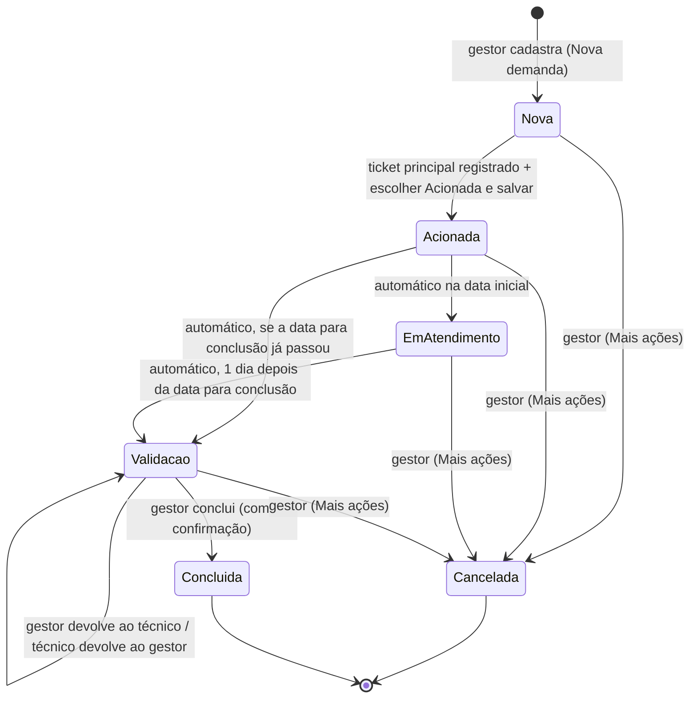

# Especificação funcional: Controle de Demandas de Mudanças

Protótipo navegável (front-end completo, sem back-end) do sistema que vai substituir a planilha Excel
**"Controle de Mudanças"** do Departamento de Suporte (DSUP) da Direção de Tecnologia da Informação e
Comunicação (DITIC) do Tribunal de Justiça do Rio Grande do Sul.

- **Autor:** Marcelo Luis da Silva Diehl (DITIC-DSUP)
- **Versão:** 1.0.0 (novembro/2026)
- **Situação:** regras de negócio e telas validadas com o setor. O próximo passo é o back-end
  (Java/Spring Boot + MySQL), usando este protótipo como especificação.

> **Para quem for continuar o projeto (inclusive o Claude):** este documento é a especificação funcional.
> Tudo o que está aqui foi decidido junto com o setor. Antes de mudar uma regra ou o visual, veja a
> seção [Decisões já tomadas](#14-decisões-já-tomadas-não-reverter-sem-falar-com-o-setor).

---

## Sumário

1. [A proposta](#1-a-proposta)
2. [Como abrir](#2-como-abrir)
3. [Arquivos](#3-arquivos)
4. [Glossário](#4-glossário)
5. [Perfis e permissões](#5-perfis-e-permissões)
6. [Fluxo da demanda](#6-fluxo-da-demanda)
7. [Regras de negócio](#7-regras-de-negócio)
8. [Telas](#8-telas)
9. [Textos gerados](#9-textos-gerados-acionamento-tickets-relatório-pdf)
10. [Modelo de dados do protótipo](#10-modelo-de-dados-do-protótipo)
11. [Proposta de banco de dados (MySQL)](#11-proposta-de-banco-de-dados-mysql)
12. [API REST sugerida](#12-api-rest-sugerida)
13. [Front-end: organização do código](#13-front-end-organização-do-código)
14. [Decisões já tomadas](#14-decisões-já-tomadas-não-reverter-sem-falar-com-o-setor)
15. [Legado: a planilha atual](#15-legado-a-planilha-atual)
16. [Próximos passos](#16-próximos-passos)

---

## 1. A proposta

Hoje cada demanda de mudança de equipamentos de informática (mudança de local, mudança de prédio,
instalação, desinstalação, rollout) é controlada numa planilha compartilhada. Uma cor de linha indica a
situação, e os números de ticket ficam espalhados em colunas. O sistema novo:

- registra a demanda a partir do **expediente SEI** e a atribui a um técnico;
- guarda o **ticket principal** e os **subtickets** do 4Biz (um por empresa contratada e serviço, com a
  quantidade de serviços);
- muda a situação **sozinho pelas datas do agendamento** e passa a demanda para a carga do gestor quando
  o atendimento começa;
- gera os textos que hoje são escritos à mão (**informação de acionamento** para o SEI e **relatório de
  execução em PDF** no modelo-mestre do DSUP);
- mantém o **histórico completo** de cada demanda e as **movimentações do dia** para o gestor;
- prepara a base para **relatórios e análise de dados** (chamados por mês, tickets por empresa, regiões).

### O fluxo real do setor

1. A demanda chega ao DITIC-DSUP por um **expediente SEI**.
2. O **gestor** analisa, cadastra a demanda no sistema e atribui a um **técnico**.
3. O técnico abre no **4Biz** o ticket principal e os subtickets (um por empresa/serviço). Depois registra
   no sistema os números, os serviços, as quantidades e a empresa, e marca a demanda como **Acionada**.
4. Na data agendada, a situação vira **Em atendimento** sozinha e a demanda vai para a carga do gestor.
5. Um dia depois da data para conclusão, vira **Para Validação** (ainda com o gestor).
6. O gestor confere o atendimento. Se faltar algo, devolve ao técnico, e a demanda continua Para Validação.
7. O gestor gera o **relatório de execução** para o expediente SEI e **conclui** a demanda.
8. Concluída, a demanda fica com o **Setor (DSUP)**, sem atribuição; o histórico guarda quem atendeu.

---

## 2. Como abrir

- Dê um duplo clique em `index.html`. Funciona **sem internet**: Bootstrap, fontes e scripts estão todos
  na pasta. Use navegadores atuais: Chrome, Edge ou Firefox.
- Os dados ficam no **localStorage do navegador** (chave `ditic-dsup-mudancas-v5`). Cada navegador tem os
  seus dados.
- O sistema começa **sem nenhuma demanda e sem nenhum técnico**: só o gestor existe até ele cadastrar a
  equipe. Os cards são criados em Nova demanda.
- **Login do gestor no protótipo:** usuário `admin`, qualquer senha, ou o botão **Entrar como gestor**
  no modal de login. O primeiro acesso exige criar uma nova senha.
- **No Spring Boot:** rode `ControleMudancasApplication` no IDE e abra `http://localhost:8088`. A tela é
  servida de `src/main/resources/static/`, cópia da pasta `front_end/`. Os pontos marcados com `API:` no
  JavaScript viram chamadas `fetch` (ver [seção 12](#12-api-rest-sugerida)).

---

## 3. Arquivos

```
front_end/
├── index.html                    página única: Bootstrap local + tema + script (com Content-Security-Policy)
├── css/
│   └── mudancas.css              tema visual: variáveis, tema do Bootstrap (--bs-*) e componentes próprios
├── js/
│   └── mudancas.js               JavaScript puro, em três partes: catálogos, gerador de PDF, aplicação
├── vendor/bootstrap/
│   ├── bootstrap.min.css         Bootstrap 5.3.3 (só o CSS; o comportamento é do mudancas.js)
│   └── LICENSE.txt               licença MIT
├── fonts/                        Inter (400/500/600/700) e IBM Plex Mono (400/500/600), woff2 + licenças OFL
├── testes/
│   └── teste_ponta_a_ponta.py    teste automático dos fluxos (opcional; precisa de Python + Playwright)
├── README.md                     apresentação da pasta
└── CLAUDE.md                     orientação curta para o Claude Code
```

São **três arquivos do sistema** (HTML, CSS e JS). `vendor/` e `fonts/` são dependências locais, para não
depender de CDN.

---

## 4. Glossário

| Termo | Significado |
|---|---|
| **Expediente SEI** | Processo administrativo que origina a demanda. Formato `8.AAAA.NNNN/NNNNNN-D` (ex.: `8.2026.9745/000342-7`). Há demandas "fora do SEI". |
| **4Biz** | Sistema de chamados (ITSM) do TJRS. |
| **Ticket principal** | Chamado do 4Biz que representa a demanda inteira (6 a 8 dígitos). |
| **Subticket** | Chamado do 4Biz para uma empresa contratada e um serviço, com a quantidade de serviços. |
| **Empresas** | CADI, CDS, Selbetti e WECOM. CDS e WECOM são pagas por serviço; CADI e Selbetti estão no valor global do contrato. |
| **Gestor** | Quem coordena as mudanças no DSUP. É o único perfil com login (no sistema: "Administrador"). |
| **Técnico** | Colega do DSUP que atende a demanda. Não tem login (ver [seção 5](#5-perfis-e-permissões)). |
| **Carga** | Com quem a demanda está agora: técnico, gestor ou Setor. |
| **Setor** | O DSUP como um todo. Demanda concluída não tem mais responsável individual. |
| **Local** | Prédio de Porto Alegre (13 prédios, região Metropolitana) ou comarca do interior (164 comarcas, cada uma com a sua região). No interior, o nome do prédio é "Foro da Comarca de X". |
| **DMP** | Depósito de material; aparece como origem ou destino no relatório (instalação e desinstalação). |
| **Bolinha azul** | Aviso de que a demanda chegou a alguém, mudou de responsável ou mudou de status, e o card ainda não foi aberto. |
| **Lixeira** | Onde a demanda excluída fica por 30 dias, podendo ser restaurada. |

---

## 5. Perfis e permissões

No protótipo, só o **gestor** entra com login e o **técnico usa o sistema sem login** (no sistema real, todos terão login: ver [Login e contas](#login-e-contas-desenho-aprovado-entra-com-o-back-end)). Ele consulta tudo e atualiza as
demandas, e as alterações feitas sem login são registradas em nome do técnico que está com a demanda.

| Ação | Técnico (sem login) | Gestor (login) |
|---|:---:|:---:|
| Consultar lista, filtros, detalhes e histórico | ✓ | ✓ |
| Editar Detalhes (SEI, local, descrição, datas, horários, informações), respeitando as travas da [seção 7.2](#72-mudança-de-status-à-mão) | ✓ | ✓ |
| Mudar o **Responsável** | — | ✓ |
| Registrar ticket principal, incluir/remover subtickets, mudar serviço e quantidade | ✓ | ✓ |
| Registrar andamento no histórico | ✓ | ✓ |
| Status: Nova → Acionada | ✓ | ✓ |
| Devolver ao gestor (na etapa Para Validação, devolvida para atendimento extra) | ✓ | — |
| Gerar informação de acionamento / copiar tickets em texto | ✓ | ✓ |
| **Nova demanda** | — | ✓ |
| **Equipe** (incluir, editar, transferir, desativar, reativar) | — | ✓ |
| Devolver demanda na etapa Para Validação ao técnico | — | ✓ |
| Alterar a Data para Conclusão em Em atendimento (com motivo) | — | ✓ |
| Gerar relatório de execução (PDF) | — | ✓ |
| **Concluir** demanda | — | ✓ |
| **Cancelar** demanda (antes de concluída, com motivo) | — | ✓ |
| **Excluir** demanda (com motivo; vai para a Lixeira; não vale para Concluída) | — | ✓ |
| **Lixeira** (consultar e restaurar) | — | ✓ |
| **Movimentações do dia** | — | ✓ |

Ações do gestor tentadas sem login abrem o modal de login. Depois de entrar, a ação continua.

Em demanda Concluída ou Cancelada, as edições acima deixam de valer para todos os perfis
([seção 7.2](#72-mudança-de-status-à-mão)).

### Login e contas (desenho aprovado; entra com o back-end)

A tabela acima descreve o protótipo. No sistema real, por enquanto sem AD/LDAP do TJRS:

- **Tudo fica atrás do login.** Não há consulta anônima. O servidor valida cada permissão.
- **Todos têm conta, com login próprio:** perfil Gestor ou Técnico. Pode haver mais de um gestor. As permissões de
  cada perfil continuam as da tabela acima, trocando "sem login" por "Técnico".
- **Um técnico pode alterar a demanda de outro.** Cada alteração fica registrada no histórico em nome de quem a fez.
- **Com mais de um gestor, a carga é compartilhada:** todos os gestores veem exatamente as mesmas demandas.
- **Não existe autocadastro.** O gestor cria a conta em **Equipe** (nome, usuário, perfil, cor). Equipe e contas são
  um cadastro só: todo responsável tem conta, e quem ainda não fez o primeiro login já pode receber demandas.
- **Primeiro acesso:** o sistema gera uma senha temporária, mostrada uma única vez e válida por 24 horas. No primeiro
  login, a pessoa é obrigada a criar a senha pessoal. O primeiro gestor é criado na instalação, com
  `mudancas.admin.senha-inicial`, e também troca a senha.
- **A Equipe mostra** nome, usuário, perfil, situação do acesso (Aguardando primeiro acesso, Ativo, Desativado) e
  último acesso. Ninguém vê a senha de ninguém: o servidor guarda só o hash (BCrypt).
- **Esqueci a senha:** a tela de login orienta a procurar o gestor. O gestor usa **Redefinir senha** na Equipe; outro
  gestor redefine a senha de um gestor. Sem nenhum gestor disponível, o responsável pelo servidor gera uma senha
  temporária por comando administrativo. A redefinição cancela a senha anterior, derruba as sessões da pessoa e fica
  registrada, sem a senha.
- **Desativar** bloqueia a entrada e mantém o histórico.
- **Sessão no servidor** com cookie protegido e encerramento por inatividade, proteção CSRF, bloqueio temporário após
  várias tentativas erradas e registro de entradas e falhas.
- **Com todos logados:** o histórico grava o autor real e a bolinha azul só some quando o destinatário abre o card.
- **AD/LDAP no futuro:** a verificação de senha fica isolada em um ponto do back-end; trocar por AD muda só esse ponto.

---

## 6. Fluxo da demanda



| Situação | Cor | Carga (com quem está) | Como entra | Status no card |
|---|---|---|---|---|
| **Nova** | branco | técnico (ou sem responsável) | Nova demanda | escolha + Salvar alterações |
| **Acionada** | amarelo | técnico | escolha + Salvar; exige ticket principal | travado; avança pela data |
| **Em atendimento** | azul | gestor ao entrar (técnico guardado); o gestor pode passar a um técnico | automático na data de agendamento | travado (cadeado) |
| **Para Validação** | laranja | gestor, ou técnico se devolvida | automático 1 dia após a data para conclusão | travado |
| **Concluída** | verde | Setor (sem responsável) | botão Concluir demanda (gestor) | travado para todos (final) |
| **Cancelada** | cinza (texto riscado) | quem estava | gestor | travado para todos (final) |

"Em aberto" = Nova + Acionada + Em atendimento + Para Validação (em desenvolvimento).
"Encerradas" = Concluída + Cancelada.

---

## 7. Regras de negócio

### 7.1 Automação pelas datas

O protótipo roda esta automação ao abrir e de hora em hora. **No sistema real, ela deve rodar no
servidor** (tarefa agendada diária, ex.: `@Scheduled` no Spring).

1. Demanda **Acionada** com `data inicial ≤ hoje` vira **Em atendimento**. A carga passa ao gestor:
   `responsavel = gestor` e `tecnico = técnico anterior`. O aviso fica para o gestor.
2. Demanda **Acionada ou Em atendimento** com `(data para conclusão ou, sem ela, data inicial) < hoje` vira
   **Para Validação**. A carga vai para o gestor, com aviso.
3. Cada mudança automática entra no histórico com o autor **Sistema (automático)**, por exemplo:
   `Status alterado automaticamente: Acionada → Em atendimento (início do agendamento em 14/11/2026).`
4. **Para Validação nunca volta para Acionada nem para Em atendimento.** Ela só avança para Concluída.

### 7.2 Mudança de status à mão

- **Escolher um status no select não altera a demanda.** A mudança só acontece em **Salvar alterações**.
  O botão aparece em qualquer aba enquanto houver status escolhido; fechar a demanda antes de salvar pede
  confirmação para descartar.
- **Em atendimento e Para Validação nunca são escolhidos à mão.** Dependem só das datas ([seção 7.1](#71-automação-pelas-datas)).
- **Acionada** exige ticket principal, Data de Início e responsável, técnico ou gestor (a demanda pode ser criada sem data e sem responsável, mas não acionada). Se faltar algum deles, o sistema abre a aba onde ele é preenchido (Tickets ou Dados) e mantém o status escolhido
  até salvar. Ao virar Acionada, grava `acionadaEm = hoje`, que é a data do acionamento no relatório.
- **Demanda para o mesmo dia:** marcar Acionada e salvar leva a demanda na hora para Em atendimento e para a
  carga do gestor.
- **Depois de acionada, a demanda não volta para Nova**, não pode perder a Data de Início e o agendamento não pode
  ser movido para o passado.
- Se o agendamento já passou, o sistema não aceita marcar Acionada: pede uma data nova primeiro, porque a
  automação levaria a demanda direto para Para Validação.
- **Cancelar** não aparece no select de status. É só do gestor, em **Mais ações**, e exige **motivo** (até 100
  caracteres), que vai para o histórico. Os dados da demanda ficam todos registrados.
- **Em atendimento e Para Validação travam os dados registrados.** Continua possível incluir ticket novo (principal,
  se não houver, e subtickets), mudar o responsável, editar as informações adicionais e cancelar. O gestor também pode alterar a Data para
  Conclusão em Em atendimento, por **Mais ações**, com motivo de até 100 caracteres: a data não pode estar no
  passado nem ser antes do início, e a alteração vai para o histórico.
- **Concluída e Cancelada são finais.** Nenhuma das duas muda de status, nem pelo gestor; Concluída não
  pode ser cancelada. Para retomar um atendimento cancelado, abre-se uma nova demanda igual.
- **Demanda encerrada é somente leitura.** Detalhes, ticket principal e subtickets não mudam mais. Continua
  possível registrar andamento no histórico, gerar os textos e, para o gestor, excluir a demanda Cancelada.
  Demanda Concluída não pode ser excluída ([seção 7.5](#75-exclusão)).
- **Concluir** é só do gestor, só a partir de Para Validação, exige ticket principal e pede confirmação. A
  demanda fica sem responsável (Setor) e guarda `tecnico`.

### 7.3 Para Validação: devolver e voltar

- O gestor pode **devolver ao técnico** (Mais ações → "Devolver a <técnico> (atendimento extra)"). A
  situação continua **Para Validação**, a carga vai ao técnico e ele recebe a bolinha azul.
- Com a demanda devolvida, o técnico vê o botão **Devolver ao gestor**. A carga volta ao gestor, com
  aviso para ele.
- A devolução vai para o último técnico que tratou da demanda.
- O gestor conclui a demanda na etapa Para Validação em qualquer caso.

### 7.4 Carga, responsável e bolinha azul

- O campo **Responsável** só muda pelo gestor, inclusive em Em atendimento e Para Validação (por exemplo, para um
  técnico acompanhar o atendimento). Em atendimento e Para Validação
  nunca ficam sem responsável: no mínimo, o gestor. Ao atribuir uma demanda a alguém, essa pessoa recebe o
  aviso ("nova", ou "retornou" se já passou por ela antes).
- O aviso (bolinha azul) tem `tipo` (nova, retornou, atendimento, pendente, status) e `para` (quem recebe).
  Acende quando a demanda entra na caixa de alguém, muda de responsável ou muda de status. **Some assim que o
  card é aberto**, por quem for.
- Toda troca de responsável entra no histórico:
  `Responsável alterado: Técnico → Gestor (carga do gestor).`

### 7.5 Exclusão

- **Demanda Concluída não pode ser excluída:** é trabalho que o setor realizou e levou adiante.
- Só o gestor, com **motivo** obrigatório (até 100 caracteres). A demanda vai para a **Lixeira** (menu da
  conta do gestor), de onde pode ser **restaurada** como estava.
- Depois de **30 dias** sem restauração, é removida automaticamente, sem retorno.
- Fica um **registro da exclusão** (data, quem, id, SEI, local, situação, motivo), que aparece nas
  Movimentações do dia, assim como a remoção definitiva.

### 7.6 Validações

| Campo | Regra |
|---|---|
| Expediente SEI | `^\d\.\d{4}\.\d{4}/\d{6}-\d$` (máscara automática ao digitar); obrigatório na Nova demanda, salvo "Fora do SEI" |
| Local | obrigatório; lista com busca (catálogo, só com o nome da comarca ou do prédio), mas aceita texto livre |
| Descrição | obrigatória na Nova demanda; até 250 caracteres |
| Informações adicionais | até 100 caracteres (só nos Detalhes, não na Nova demanda) |
| Datas | `dd/mm/aaaa` (máscara + calendário próprio), anos 2000–2100, data real; na Nova demanda e ao alterar a data de uma demanda Nova, hoje ou futura (ou em branco); a final exige a de agendamento e não pode ser antes dela; sem data para conclusão, o atendimento é de um dia só |
| Hora | `hh:mm`, 00:00–23:59, opcional; é a hora do início, no primeiro dia |
| Motivo (cancelar, excluir e alterar a Data para Conclusão) | obrigatório, até 100 caracteres |
| Nova senha | pelo menos 8 caracteres, confirmada e diferente da inicial |
| Ticket principal | só dígitos, 6 a 8 |
| Subtickets | um ou mais números de 6 a 8 dígitos no mesmo campo (ex.: `1831365 / 1831398`); número repetido na demanda é ignorado; empresa e serviço obrigatórios (a empresa começa sem seleção); quantidade 1–999 |
| Equipe | nome obrigatório, único, até 60 caracteres; cor da paleta; iniciais geradas pelo nome |

### 7.7 Serviços por empresa (subtickets)

| Empresa | Serviços |
|---|---|
| CADI | Mudança de Local, Configuração, Habilitação de Pontos de Rede |
| CDS | Instalação, Desinstalação, Rollout AC, Rollout ABC, Mudança de Local, Mudança de Prédio |
| Selbetti | Mudança de Local, Instalação, Desinstalação, Mudança de Prédio |
| WECOM | Instalação, Desinstalação, Mudança de Local, Mudança de Prédio, Instalação de Infraestrutura |

### 7.8 Equipe

- O gestor inclui, edita (nome e cor), **transfere** as demandas em aberto que estão com uma pessoa
  para outra (todas ou só as marcadas), **desativa** e **reativa**.
- Ninguém é excluído, para não perder o histórico. Para desativar quem tem demandas em aberto, o sistema
  pede antes para transferi-las.
- Quem está inativo some da Nova demanda e do campo Responsável, mas continua nas demandas antigas.

### 7.9 Histórico

Cada movimento é uma linha com data e hora, autor e texto: criação, status (manual ou automático),
responsável, agendamento, dados, ticket, subticket (inclusão, remoção, serviço, quantidade), devoluções,
textos gerados e anotações livres ("Registrar andamento").

---

## 8. Telas

### 8.1 Lista (tela principal)

- **Cabeçalho:** "DITIC-DSUP | Controle de Mudanças". À direita: **Entrar**, ou, para o gestor, **Nova
  demanda** e o menu da conta (Equipe, Movimentações do dia, Lixeira, Sair da conta).
- **Abas de situação** (uma por vez), com contagem. À esquerda as em desenvolvimento: **Em aberto**
  (padrão), Novas, Acionadas, Em Atendimento, Para Validação. Na ponta direita as encerradas:
  Concluídas, Canceladas. Não há aba "Todas". Teclado: setas, Home e End.
- **Pesquisa:** busca por SEI, descrição, local, informações, número, ticket principal e subtickets.
- **Filtros:** Local (com busca; lista só os locais que têm demandas) e Responsável (com o total de cards de
  cada um, independente de aba, pesquisa e demais filtros, incluindo "Gestor" e "Sem responsável").
- **Visualização:** **linhas** (10 por folha) ou **post-its** (8 por folha, 4 × 2), sempre com a mesma
  altura, haja 1 ou 10 na folha.
- **Colunas:** Expediente, Local, Data, Ticket, Status, Responsável. Todas ordenáveis; o padrão é Data,
  da mais nova para a mais antiga. Também mostra o prazo: a contagem até o início nas demandas Novas e Acionadas ("02 dias", "01 dia", "120 dias", no
  máximo 3 dígitos), "Hoje", "Até 09/11" e "Há 2 dias". Demanda Nova cujo período já
  terminou ganha **bolinha vermelha** e a data em **negrito vermelho**, nas linhas e nos post-its.
- **Rodapé da lista:** "Mostrando 1–10 de 46 demandas", mensagens de confirmação e paginação.

### 8.2 Detalhes da demanda (modal)

- **Topo:** nome do prédio, status (lista de escolha, ou selo com cadeado quando travado), SEI com botão
  de copiar, ticket, agendamento, região e com quem está.
- **Aba Detalhes:** Expediente (SEI, local, descrição) e Atendimento (responsável, Data de Início,
  Data para Conclusão e Hora, as duas últimas opcionais, informações adicionais). "Salvar alterações" só fica ativo quando há mudança, inclusive
  de status; se a pessoa sair sem salvar, o sistema pergunta antes de descartar.
- **Aba Tickets:** ticket principal (registrar ou alterar) e subtickets (empresa, número, serviço,
  quantidade, editáveis na tabela).
- **Aba Histórico:** linha do tempo e campo para registrar andamento.
- **Mais ações:** Gerar relatório de mudança (gestor, em Para Validação e Concluída), Devolver ao técnico (gestor),
  Gerar informação de acionamento, Copiar tickets em texto, Alterar Data para Conclusão (gestor, Em atendimento), Cancelar e Excluir (gestor; Excluir não aparece em Concluída).
- **Rodapé:** Fechar, Devolver ao gestor (técnico, Para Validação devolvida), Concluir demanda (gestor,
  Para Validação) e Salvar alterações.

### 8.3 Outros modais

- **Nova demanda** (gestor): "Informações Iniciais" (SEI ou "Fora do SEI", local, Data de Início,
  Data para Conclusão e Hora, as duas últimas opcionais, descrição) e "Atribuição da Demanda" (técnico, Gestor ou "Definir depois"). Ao incluir, mostra
  a confirmação com o número para copiar, e os botões Incluir outra / Abrir demanda / Concluir.
- **Equipe** (gestor): incluir, editar, transferir, desativar e reativar.
- **Movimentações do Dia** (gestor): tudo o que mudou no dia, com hora, autor e demanda (clicável, abre
  no Histórico). Setas para os dias anteriores e filtro "Todas" / "Só status".
- **Informação de Acionamento:** texto pronto para o SEI, editável, com botão de copiar.
- **Relatório de Execução de Mudança:** formulário preenchido automaticamente que baixa o PDF.
- **Lixeira** (gestor): demandas excluídas, com motivo, dias restantes e botão Restaurar.
- **Entrar:** login do gestor; no primeiro acesso, pede a criação da senha.
- **Informações do Sistema** (clique no rodapé): versão, termos de uso e propriedade técnica.

Os modais **não fecham** com clique fora nem com Esc: só pelo X ou pelos botões do próprio modal.

Nova demanda, Equipe, Transferir Demandas e Lixeira têm **altura única**: o conteúdo a mais rola por dentro do
campo (responsáveis, Pessoas a partir da 6ª, demandas em aberto e demandas excluídas). A altura só cede quando
não cabe na janela e no layout de celular.

### 8.4 Responsivo

Funciona do celular (390 px) a telas grandes.

- **Abaixo de 1330 px:** o título sobe para cima das abas.
- **No celular:** as abas rolam na horizontal, a lista vira cartões empilhados e os modais abrem de baixo
  para cima.
- **Em telas a partir de 900 × 560:** a página não rola; a folha ocupa a altura disponível.

---

## 9. Textos gerados (acionamento, tickets, relatório PDF)

### 9.1 Informação de acionamento (para o SEI)

```
Ao Serviço de Gestão de Mudanças,

Em atenção ao Agendamento, informo que as empresas contratadas da DITIC já foram acionadas para o atendimento da demanda:

Agendamento: 14/11/2026, 9h.            ← ou "Agendamento Inicial: … / Agendamento Final: …", ou "a definir"

CADI: 1831365 / 1831398
CDS: 1831402

Era o que cumpria informar.
```

Com uma empresa só: "a empresa contratada da DITIC já foi acionada". Sem horário: ", horário a definir".
Copiar o texto registra no histórico.

### 9.2 Copiar tickets em texto

Uma linha separada por tabulação, pronta para colar numa planilha:
`Ticket: 1830625⇥CADI: 1831365 / 1831398⇥CDS: -⇥Selbetti: -⇥WECOM: -`

### 9.3 Relatório de execução de mudança (PDF A4)

O PDF é gerado no próprio navegador pelo `RelatorioPDF` (parte 2 do `mudancas.js`), com Helvetica, sem
bibliotecas. Ele segue o modelo-mestre do DSUP:

- **Cabeçalho:** Direção de Tecnologia da Informação e Comunicação / Departamento de Suporte / Serviço de
  Projetos e Contrato de Suporte.
- **Quadro:**
  - Data do Acionamento: `acionadaEm`, ou a data do histórico.
  - Data da Execução: o agendamento.
  - Serviços realizados (Mudança de Prédio, Desinstalação, Mudança de Local, Instalação): marcados pelos
    serviços dos subtickets.
  - Local de origem e Local de destino:
    - origem = `DMP` se há Instalação; o local, se há Mudança de Local, Mudança de Prédio ou
      Desinstalação.
    - destino = o local, se há Mudança de Local, Mudança de Prédio ou Instalação (ou se não há
      Desinstalação); `DMP – Carga CDS` se há Desinstalação.
  - Custo (aproximado): vazio para preencher quando há CDS ou WECOM; `-` quando não há.
- **Corpo:** "Em atendimento à demanda solicitada a esse DITIC-DSUP, referente às mudanças de equipamentos
  de informática, informo que foram realizadas:", seguido de **um item por subticket**, numerado
  `1 - `, `2 - `…:
  > 1 - Mudança de local de equipamentos de informática, em total de 12 serviços, no Foro da Comarca de
  > Canoas. A atividade foi executada pela contratada CDS através do ticket 1831365.

  Em Instalação de Infraestrutura e Habilitação de Pontos de Rede, o item não leva "de equipamentos de
  informática".
- **Frase de custo, automática:** "Custo incluído no valor global do contrato." entra **só quando não há
  subtickets da CDS nem da WECOM**. Com elas há valor a pagar, e a frase não entra.
- **Fecho:** "Era o que cabia informar."
- **Arquivo:** `Relatório de execução - <SEI com hífens>.pdf`. Gerar o PDF registra no histórico.

Todos os campos podem ser revisados no formulário antes de baixar.

---

## 10. Modelo de dados do protótipo

O estado fica no `localStorage`, como JSON:

```js
{
  demandas: [Demanda], equipe: [Pessoa], usuario: 'admin' | null,
  sitAtivas: ['nova','acionada','atendimento','pendente'] | ['<uma situação>'],
  vista: 'linhas' | 'postits', excluidas: [Exclusao], lixeira: [Demanda], senhaDefinida: boolean
}
```

**Demanda**

| Campo | Tipo | Observação |
|---|---|---|
| `id` | número | sequencial (no banco: chave primária) |
| `sei` | texto | `''` quando "Fora do SEI" |
| `descricao` | texto ≤ 250 | |
| `comarca` | texto | nome do local (prédio de POA ou comarca do interior, sem "Foro da Comarca de") |
| `responsavel` | texto \| null | id do técnico, `'admin'` (gestor) ou `null` (sem responsável / Setor) |
| `tecnico` | texto \| null | técnico que atendeu (guardado quando a carga vai ao gestor ou ao Setor) |
| `inicio`, `fim` | `AAAA-MM-DD` \| null | `fim = null` quando é um dia só |
| `hora` | `HH:MM` \| null | hora do início, no primeiro dia |
| `situacao` | `nova` \| `acionada` \| `atendimento` \| `pendente` \| `concluida` \| `cancelada` | os ids internos não mudaram; na tela, `nova` aparece como Novas e `pendente` como Para Validação |
| `ticketPrincipal` | texto \| null | 6–8 dígitos |
| `ticketEm` | `{ data, usuario }` | quando e por quem o ticket foi registrado |
| `acionadaEm` | `AAAA-MM-DD` | data em que virou Acionada |
| `subtickets` | `[{ empresa, numero, finalidade, quantidade }]` | `finalidade` = serviço |
| `informacoes` | texto ≤ 100 | |
| `historico` | `[{ data: 'AAAA-MM-DDTHH:MM', usuario, texto }]` | `usuario`: id do técnico, `'admin'`, `'sistema'` ou `'tecnico'` |
| `criadaEm` | `AAAA-MM-DD` | |
| `passou` | `[id]` | por quem a demanda já passou (decide entre aviso "nova" e "retornou") |
| `aviso` | `{ tipo, para, em }` \| null | bolinha azul |
| `motivoCancelamento` | texto ≤ 100 | só em demanda cancelada |
| `excluidaEm`, `excluidaPor`, `motivoExclusao` | | só enquanto está na lixeira |

**Pessoa (equipe):** `{ id, nome, curto, ini, cor: '#RRGGBB', ativo }`.
**Exclusão:** `{ data, usuario, id, sei, comarca, situacao, motivo?, texto? }`.

---

## 11. Proposta de banco de dados (MySQL)

É uma sugestão de partida para o back-end. Nomes em português, como no resto do sistema.

```sql
-- quem usa o sistema: gestores e técnicos (a Equipe é este cadastro)
CREATE TABLE pessoa (
  id            BIGINT AUTO_INCREMENT PRIMARY KEY,
  login         VARCHAR(60)  NOT NULL UNIQUE,
  nome          VARCHAR(60)  NOT NULL UNIQUE,
  nome_curto    VARCHAR(30)  NOT NULL,
  iniciais      CHAR(2)      NOT NULL,
  cor           CHAR(7)      NOT NULL,             -- #RRGGBB
  perfil        ENUM('GESTOR','TECNICO') NOT NULL DEFAULT 'TECNICO',
  senha_hash    VARCHAR(100) NULL,                 -- BCrypt; NULL só se a autenticação vier a ser pela rede
  deve_trocar_senha BOOLEAN NOT NULL DEFAULT TRUE, -- primeiro acesso ou senha temporária
  senha_temporaria_expira_em DATETIME NULL,
  tentativas_falhas SMALLINT NOT NULL DEFAULT 0,
  bloqueado_ate DATETIME NULL,
  ultimo_acesso DATETIME NULL,
  ativo         BOOLEAN NOT NULL DEFAULT TRUE
);

CREATE TABLE local (
  id            BIGINT AUTO_INCREMENT PRIMARY KEY,
  nome          VARCHAR(120) NOT NULL UNIQUE,      -- 'Foro Central - Prédio I' ou 'Canoas'
  tipo          ENUM('PREDIO_POA','COMARCA') NOT NULL,
  regiao        VARCHAR(40)  NOT NULL              -- Metropolitana, Noroeste, Sudeste…
);

CREATE TABLE empresa (
  id            BIGINT AUTO_INCREMENT PRIMARY KEY,
  nome          VARCHAR(30) NOT NULL UNIQUE,       -- CADI, CDS, Selbetti, WECOM
  paga_por_servico BOOLEAN NOT NULL,               -- CDS e WECOM = TRUE (regra da frase de custo)
  sla_dias      TINYINT NOT NULL                   -- CDS e WECOM = 2; CADI e Selbetti = 1
);

CREATE TABLE servico (
  id            BIGINT AUTO_INCREMENT PRIMARY KEY,
  empresa_id    BIGINT NOT NULL REFERENCES empresa(id),
  nome          VARCHAR(40) NOT NULL,              -- 'Mudança de Local', 'Rollout ABC'…
  UNIQUE (empresa_id, nome)
);

CREATE TABLE demanda (
  id                 BIGINT AUTO_INCREMENT PRIMARY KEY,
  sei                VARCHAR(20)  NULL,            -- NULL = fora do SEI
  descricao          VARCHAR(250) NOT NULL,
  local_id           BIGINT       NULL REFERENCES local(id),
  local_texto        VARCHAR(120) NOT NULL,        -- o texto digitado (o catálogo aceita texto livre)
  data_inicio        DATE NULL,
  data_fim           DATE NULL,
  horario            TIME NULL,
  situacao           ENUM('NOVA','ACIONADA','EM_ATENDIMENTO','PARA_VALIDACAO','CONCLUIDA','CANCELADA') NOT NULL DEFAULT 'NOVA',
  motivo_cancelamento VARCHAR(100) NULL,
  excluida_em        DATETIME NULL,                -- preenchido = está na lixeira; apagar depois de 30 dias
  excluida_por       VARCHAR(60) NULL,
  motivo_exclusao    VARCHAR(100) NULL,
  carga              ENUM('TECNICO','GESTOR','SETOR','SEM_RESPONSAVEL') NOT NULL,
  tecnico_id         BIGINT NULL REFERENCES pessoa(id),   -- responsável (carga TECNICO) ou quem atendeu (GESTOR/SETOR)
  ticket_principal   VARCHAR(8) NULL,
  ticket_em          DATETIME NULL,
  ticket_por         VARCHAR(60) NULL,
  acionada_em        DATE NULL,
  informacoes        VARCHAR(100) NULL,
  aviso_tipo         ENUM('NOVA','RETORNOU','ATENDIMENTO','PARA_VALIDACAO','STATUS') NULL,
  aviso_para         VARCHAR(60) NULL,             -- 'GESTOR' ou id do técnico
  aviso_em           DATETIME NULL,
  criada_em          DATETIME NOT NULL,
  atualizada_em      DATETIME NOT NULL,
  INDEX (situacao), INDEX (tecnico_id), INDEX (data_inicio), INDEX (sei)
);

CREATE TABLE demanda_tecnico_passou (               -- decide aviso "nova" × "retornou"
  demanda_id BIGINT NOT NULL REFERENCES demanda(id) ON DELETE CASCADE,
  tecnico_id BIGINT NOT NULL REFERENCES pessoa(id),
  PRIMARY KEY (demanda_id, tecnico_id)
);

CREATE TABLE subticket (
  id            BIGINT AUTO_INCREMENT PRIMARY KEY,
  demanda_id    BIGINT NOT NULL REFERENCES demanda(id) ON DELETE CASCADE,
  empresa_id    BIGINT NOT NULL REFERENCES empresa(id),
  numero        VARCHAR(8) NOT NULL,
  servico_id    BIGINT NULL REFERENCES servico(id),
  quantidade    SMALLINT NOT NULL DEFAULT 1 CHECK (quantidade BETWEEN 1 AND 999),
  UNIQUE (demanda_id, numero)
);

CREATE TABLE historico (
  id            BIGINT AUTO_INCREMENT PRIMARY KEY,
  demanda_id    BIGINT NOT NULL REFERENCES demanda(id) ON DELETE CASCADE,
  data_hora     DATETIME NOT NULL,
  autor         VARCHAR(60) NOT NULL,              -- 'SISTEMA', 'GESTOR:<login>' ou 'TECNICO:<id>'
  tipo          ENUM('CRIACAO','STATUS','STATUS_AUTOMATICO','RESPONSAVEL','AGENDAMENTO','DADOS',
                     'TICKET','SUBTICKET','DOCUMENTO','NOTA') NOT NULL,
  texto         VARCHAR(500) NOT NULL,
  INDEX (data_hora)                                -- Movimentações do dia
);

CREATE TABLE demanda_excluida (                     -- auditoria da exclusão
  id            BIGINT AUTO_INCREMENT PRIMARY KEY,
  demanda_id    BIGINT NOT NULL,
  sei           VARCHAR(20) NULL,
  local_texto   VARCHAR(120) NULL,
  situacao      VARCHAR(20) NOT NULL,
  excluida_em   DATETIME NOT NULL,
  excluida_por  VARCHAR(60) NOT NULL,
  motivo        VARCHAR(100) NULL
);
```

**De → para (protótipo → banco):**

- `responsavel = 'admin'` → `carga = 'GESTOR'`.
- `responsavel = <técnico>` → `carga = 'TECNICO'` e `tecnico_id`.
- `responsavel = null` em demanda concluída → `carga = 'SETOR'`, com `tecnico_id` = quem atendeu.
- `responsavel = null` nas demais → `carga = 'SEM_RESPONSAVEL'`.
- `finalidade` → `servico_id`; `comarca` → `local_texto` (+ `local_id` quando estiver no catálogo).
- Os catálogos de locais, regiões e serviços estão na parte 1 do `mudancas.js` e podem virar os
  `INSERT`s iniciais.

---

## 12. API REST sugerida

No JavaScript, cada ponto que vira chamada ao servidor está marcado com `// API:`.

| Método | Caminho | Uso |
|---|---|---|
| POST | `/api/login` | entrar (gestor); informa se precisa trocar a senha |
| POST | `/api/conta/senha` | `{ atual, nova }`: primeiro acesso ou senha temporária |
| GET | `/api/mudancas?situacao=&responsavel=&local=&q=&ordem=&pagina=` | lista |
| POST | `/api/mudancas` | nova demanda (gestor) |
| PUT | `/api/mudancas/{id}` | salvar Detalhes |
| PATCH | `/api/mudancas/{id}/situacao` | mudar status, concluir, cancelar com `motivo` (regras da [seção 7](#7-regras-de-negócio)) |
| PUT | `/api/mudancas/{id}/ticket` | ticket principal |
| POST | `/api/mudancas/{id}/subtickets` | incluir subticket(s) |
| PATCH / DELETE | `/api/mudancas/{id}/subtickets/{numero}` | serviço/quantidade / remover |
| GET / POST | `/api/mudancas/{id}/historico` | histórico / registrar andamento |
| POST | `/api/mudancas/{id}/devolver-tecnico` · `/devolver-gestor` | Para Validação: atendimento extra |
| DELETE | `/api/mudancas/{id}` | `{ motivo }`: envia para a lixeira (gestor; grava `demanda_excluida`; recusa demanda Concluída) |
| GET | `/api/lixeira` | demandas na lixeira (gestor) |
| POST | `/api/lixeira/{id}/restaurar` | restaurar (gestor) |
| GET | `/api/movimentacoes?dia=AAAA-MM-DD` | Movimentações do dia (gestor) |
| GET / POST / PUT | `/api/equipe`, `/api/equipe/{id}` | equipe e contas (gestor) |
| POST | `/api/equipe/{id}/redefinir-senha` | gera senha temporária (gestor) |
| POST | `/api/logout` | encerrar a sessão |
| PATCH | `/api/mudancas/{id}/conclusao` | `{ data, motivo }`: alterar a Data para Conclusão (gestor, Em atendimento) |
| POST | `/api/equipe/{id}/transferir` | `{ para, demandas: [ids] }` |
| GET | `/api/catalogos` | locais, regiões, empresas e serviços |

As permissões da [seção 5](#5-perfis-e-permissões) devem ser validadas **no servidor**. A tela só
esconde os botões.

---

## 13. Front-end: organização do código

- **HTML** (`index.html`): só o esqueleto (`<div id="app">`). Tem uma `Content-Security-Policy` que só
  aceita arquivos da própria pasta (sem CDN, sem `eval`) e libera estilos inline apenas para os atributos
  `style` das telas.
- **CSS** (`css/mudancas.css`):
  - O Bootstrap 5.3.3 entra antes. Este arquivo define as variáveis do sistema (`--ink`, `--line`,
    `--accent`…) e as cores de cada situação (`--acio-bg`, `--pend-dot`…).
  - Também traz o **tema do Bootstrap**: as variáveis `--bs-*` de botões, formulários, modais, menus,
    cards, tabela, paginação, list-group e badge.
  - Depois vêm os componentes próprios, em blocos comentados.
- **Componentes do Bootstrap usados:**
  - botões: `.btn` com `.btn-primary`, `.btn-outline-secondary`, `.btn-link`, `.btn-success`,
    `.btn-danger`, `.btn-lg`, `.btn-sm`;
  - formulários: `.form-control`, `.form-select`, `.form-label`;
  - modais: `.modal` › `.modal-dialog` › `.modal-content` › `.modal-header/.modal-body/.modal-footer`;
  - menus: `.dropdown-menu`, `.dropdown-item`, `.dropdown-header`, `.dropdown-divider`;
  - navegação: `.nav`, `.nav-underline`, `.nav-link`, `.pagination`;
  - conteúdo: `.card` com `.card-header/.card-body/.card-footer`, `.table`, `.badge`, `.alert`,
    `.list-group`;
  - layout e utilitários: `.row`/`.col-md-6`, `.btn-group`, `.visually-hidden`, `.w-100`.
  - O comportamento (abrir e fechar modais e menus) é do `mudancas.js`. O `bootstrap.bundle.js` não é
    usado.
- **JS** (`js/mudancas.js`), um único IIFE em modo estrito:
  1. `CATALOGO_LOCAIS`, `REGIAO_COMARCA`, `SERVICOS_CDS`.
  2. `RelatorioPDF.gerar(r)`: o gerador do PDF.
  3. A aplicação:
     - **Estado:** o objeto `E` é a fonte única da verdade. `persistir()` grava no localStorage.
     - **Desenho:** `desenhar()` redesenha a tela inteira a partir de `E` (`telaTopo`, `telaPainel`,
       `telaDetalhe`, `telaModal`…), preservando o foco, o texto digitado e a rolagem.
     - **Eventos:** são delegados no `document`. Os cliques usam `data-acao` (um `switch` por ação), os
       formulários usam `data-form` (`enviar(form)`) e os campos de rascunho usam `data-rascunho`.
     - **Regras:** `automatizar()`, `destinosStatus()`, `salvarStatus()`, `concluir()`, `atribuir()`, `paraGestor()`,
       `paraSetor()`, `avisar()` e `registrar()`, que grava no histórico.
     - **Permissões:** `ehGestor()`, `precisaGestor()`, `precisaEditar()`.
- **Segurança:**
  - Todo dado entra no HTML por `esc()`. As cores passam por `corOk()` (só `#RRGGBB`).
  - Os dados lidos do localStorage passam por uma checagem mínima de formato.
  - Não há `eval`, `new Function` nem recursos externos.
- **Acessibilidade:**
  - `role="tablist"` e `role="tab"` com navegação por teclado; `aria-selected`, `aria-expanded`,
    `aria-invalid`.
  - Rótulos visíveis ou `.visually-hidden`; foco visível.
  - O Esc recolhe menus e calendário; os modais fecham só pelo X ou pelos botões deles. Enter abre a demanda.
- **Teste automático** (opcional): `pip install playwright` e depois
  `python testes/teste_ponta_a_ponta.py`. Ele cria as próprias demandas e passa pelos fluxos principais
  (146 verificações) usando o Chromium do Playwright.

---

## 14. Decisões já tomadas (não reverter sem falar com o setor)

**Nomes**

- Nome do sistema: **Controle de Demandas de Mudanças**. No cabeçalho: "DITIC-DSUP | Controle de
  Mudanças".
- Abas de situação: **Novas, Acionadas, Em Atendimento, Para Validação, Concluídas, Canceladas**. No selo de
  cada demanda, no singular. Novas são as demandas ainda sem acionamento (antes `Cadastrada`); Para Validação
  era `Pendente de conclusão`.
  Cores: branco, amarelo, azul, laranja, verde, cinza. A antiga "Sobrestada" saiu.
- O gestor aparece como **Administrador** (não "Gestor DSUP").

**Lista principal**

- Título da lista: **Filtro de Demanda**, em fonte menor.
- Abas de situação: **Em aberto** + uma por situação, uma por vez; as encerradas na ponta direita.
  **Sem aba "Todas"**.
- Linhas e post-its **sempre do mesmo tamanho**: 10 linhas ou 8 post-its por folha.
- Post-its sem fita nem rotação, alinhados e sem fundo pontilhado.
- Aviso de demanda nova: **só a bolinha azul**, sem tarjas (NOVA/RETORNOU/PENDENTE foram retiradas).
- A mensagem de confirmação da página aparece no rodapé da lista, para não empurrar as linhas.

**Formulários**

- Período exibido por extenso: `12/11/2026 até 13/11/2026`; no card, `12/11/2026 às 09:00 até 13/11/2026`.
- Datas, nesta ordem: "Data de Início", "Data para Conclusão" e "Hora", todas opcionais, sem o texto "(opcional)" na tela;
  formato dd/mm/aaaa, com calendário próprio e digitação.
- O select de Empresa dos subtickets começa sem seleção.
- Modais fecham só pelo X ou pelos botões deles: clique fora e Esc não fecham.
- Rótulos "Expediente" e "Ticket" (sem "SEI" nem "Principal" na lista).
- Nova demanda:
  - blocos "Informações Iniciais" e "Atribuição da Demanda", sem números;
  - data ao lado do local;
  - descrição até 250 caracteres;
  - "Informações adicionais" (até 100) só nos Detalhes.

**Perfis e permissões**

- No protótipo, **só o gestor tem login**. No sistema real, todos têm conta própria, criada pelo gestor.
- Antes de entrar, só aparece o botão Entrar. Nova demanda aparece depois do login do gestor.
- Cancelar, excluir, concluir, relatório, Equipe e Movimentações do dia são **só do gestor**.

**Fluxo**

- Em atendimento e Para Validação **travam o status** e só entram pelas datas. Para Validação nunca volta para Acionada.
- Em atendimento e Para Validação, os dados registrados travam; o gestor ainda pode mudar o responsável.
- Cancelar e excluir exigem motivo e ficam só em Mais ações; o select de status não oferece Cancelada.
- Demanda excluída fica 30 dias na Lixeira. Demanda Concluída não pode ser excluída.
- Não se cria demanda com data anterior à do dia: hoje, futura ou em branco.
- Ticket principal é obrigatório para acionar. Em acionamento direto em ticket independente, esse ticket é registrado como principal.
- Acionar exige só o ticket principal; subticket não é obrigatório.
- O número do SEI pode se repetir em mais de uma demanda.
- Não há controle de SLA: basta a contagem dos dias até a demanda passar a Em atendimento. Pode haver demanda para o mesmo dia.
- A bolinha azul some ao abrir o card, por quem for.
- O sistema novo não traz técnicos cadastrados.
- Depois de acionada, a demanda **não volta para Nova**.
- **Concluída e Cancelada são finais**: não mudam mais de status, nem pelo gestor, e ficam somente leitura.
- O status escolhido no select só vale depois de **Salvar alterações**.
- Concluída fica **sem atribuição (Setor)**.
- Quantidade obrigatória nos subtickets. O texto do item do relatório e a regra da frase de custo
  global ficam como na [seção 9](#9-textos-gerados-acionamento-tickets-relatório-pdf).

**Visual**

- Aparência igual em qualquer navegador: só tema claro, barras de rolagem claras e caixas de marcar
  próprias.
- Uma "revisão visual" com cabeçalho escuro e chips coloridos foi **rejeitada**. Manter o visual atual.

---

## 15. Legado: a planilha atual

- Arquivo "Planilha de Controle de Mudanças.xlsx", aba **Página1**, cerca de 1.050 linhas preenchidas.
- **Colunas:** Expediente SEI · Descrição · Comarca · Responsável · Data do Agendamento · ticket
  principal · ticket CADI · ticket CDS · ticket Selbetti · Ticket WECOM · Informações Adicionais.
- **A situação está na cor da linha:** verde = concluída, amarelo = acionada, branco = nova,
  vermelho = cancelada, laranja = sobrestada (hoje, para validação).
- Os tickets de cada empresa vêm numa só célula, separados por " / ".
- **Decisão (novembro/2026):** as planilhas existentes não serão importadas; o sistema começa do zero.
- **Depois:** uma tela de **análise de dados**: demandas por mês, tickets principais e subtickets por
  empresa, regiões atendidas, tempo entre acionamento e conclusão.

---

## 16. Próximos passos

1. Back-end Spring Boot + MySQL com o modelo da [seção 11](#11-proposta-de-banco-de-dados-mysql) e a
   API da [seção 12](#12-api-rest-sugerida). As regras de status e permissão devem ficar no servidor.
2. Tarefa agendada diária para a automação das datas ([seção 7.1](#71-automação-pelas-datas)) e para limpar a
   lixeira ([seção 7.5](#75-exclusão)).
3. Login e contas para todos, com recuperação de senha pelo gestor
   ([seção 5](#login-e-contas-desenho-aprovado-entra-com-o-back-end)).
4. Trocar o `localStorage` por chamadas `fetch` nos pontos `// API:`.
5. Tela de análise de dados e relatórios.
6. Geração do PDF no servidor (opcional; o gerador do navegador já atende ao modelo-mestre).
